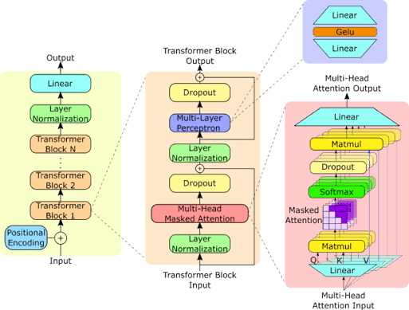

## Inference engine in Go

This repository is a GPT-2 inference engine written from scratch in Go for the CodeCrafters "Build Your Own Inference Engine" challenge. It reads the real GPT-2 weights from a `.safetensors` file, runs the transformer forward pass with hand-written tensor code (no ML libraries), and generates new tokens with either greedy search or top-p sampling. Generation uses a key-value cache so that each new token costs one row of work instead of a full pass over the whole context.

The notes in this repository are written around one running example, the prompt "The capital of France is". GPT-2's tokenizer turns it into five ids:

| Position | Id | Token |
| --- | --- | --- |
| 0 | 464 | `The` |
| 1 | 3139 | ` capital` |
| 2 | 286 | ` of` |
| 3 | 4881 | ` France` |
| 4 | 318 | ` is` |

The notes are split so that each topic lives in one place:

| File | What it covers |
| --- | --- |
| `README.md` (this file) | How the engine is put together, the lessons I took away from building it, and how to run it. |
| `concepts.md` | The arithmetic behind each challenge stage, worked through by hand on the small inputs the stages send. |
| `kv-cache.md` | How the key-value cache works, the difference between prefill and decode, and why the causal mask needs an offset. |
| `extensions.md` | Small checkpoints for other attention types and position embeddings, and the order to add them. |
| `performance.md` | Memory measurements for Run GPT-2, and a place for CPU profiles. |

## How one token gets generated



Every generated token goes through the same pipeline:

1. **Embedding.** Each token id selects a row of 768 numbers from `wte.weight`, and each position selects a row from `wpe.weight`. The two rows are added, so the model knows both which token it is looking at and where that token sits in the prompt. For the running example this produces a `[5, 768]` tensor.
2. **Twelve transformer blocks.** Each block runs layer norm, then multi-head attention, then adds the result back onto its input (the residual). It then runs a second layer norm and the MLP, and adds that result back as well. Attention is the only step where one position reads information from another; everything else works on each row independently.
3. **Output head.** Only the last row matters for predicting the next token, so the engine keeps the row for " is", applies the final layer norm `ln_f`, and multiplies it by the transpose of `wte.weight`. GPT-2 reuses the token embedding table as its output layer, which is why the result has one score (a logit) for each of the 50,257 tokens in the vocabulary.
4. **Choosing a token.** Greedy search takes the id with the largest logit. Top-p sampling turns the logits into probabilities and picks from the smallest set of likely tokens. Both are described in Choosing the next token.

Inside attention the order of operations is: compute the scores, apply the causal mask, take the softmax, multiply by the values, merge the heads back together, and apply the output projection. `concepts.md` walks through each of these with real numbers.

## What I learned building it

These are the lessons from building the engine. Most of them first showed up as a bug, and the commit history records the fix.

#### Most of the work was tracking tensor shapes

The math inside a transformer uses only a few operations: matrix products, a few element-wise functions, softmax, and layer norm. What took the most effort was keeping track of what shape each tensor has at every step and which axis an operation runs along. Writing the expected shape next to each step, as in the comments in `internal/models/gpt2/model.go`, makes it possible to check every intermediate tensor against what it should be. For example, `c_attn` produces a fused `[positions, 3 * 768]` tensor, and each attention head has to cut its own 64 columns out of the query, key, and value blocks inside that fused row.

#### There are two different kinds of "multiply"

My first `multiply` function handled both matrix products and per-column scaling, and decided which one to do by looking at the shapes of its two inputs. That made the attention code hard to read, because a line such as `layerNorm.multiply(weights)` did not say which operation it performed, and a shape mistake could silently select the other one instead of failing. I split it into `tensor.MatMul`, used for the learned weight matrices such as `c_attn` and `c_proj`, and `tensor.BroadcastMultiply`, used for layer norm's per-column scale. Now each call site states which operation it expects, and a wrong shape produces an error.

#### Go value receivers do not protect the underlying slice

A `Tensor` method with a value receiver gets a copy of the struct, but the copy still points to the same `Values` slice. My early `add` and `scale` functions wrote into `t1.Values` and returned `t1`, which also changed the caller's tensor. I fixed this early, before attention existed, but it would have broken the residual connection later, because the block adds its original input back at the end and that input must still hold its original values. Every tensor operation now clones `Values` before writing and returns a new tensor.

#### Each block has to read the previous block's output

My first version of the logits command passed the original embeddings into all twelve blocks instead of chaining them, so each block's output was thrown away except the last one. The shapes were all correct, so nothing failed, but the logits were wrong. Shape checks cannot catch this kind of bug; the only way to see it is to compare the numbers with a reference output.

#### Small numeric choices matter when a tester compares floats

The tester compares output to a reference implementation within a tolerance of `0.0001`. Two details were enough to fail:

- GPT-2 uses the tanh approximation of GELU. The exact GELU (based on the error function) differs by up to `0.00047` on some inputs, which is above the tolerance.
- Layer norm divides by `sqrt(variance + eps)`. Writing `sqrt(variance) + eps` instead gives a noticeably different result when the variance is small.

#### Sampling has to be reproducible to be testable

Top-p sampling is random, so the tester supplies the random numbers on standard input, one per generated token. That makes the output reproducible, but only if the engine follows the same procedure as the reference implementation in every detail, including the order of tokens with equal probability and whether the comparison with the random number is `>` or `>=`. A single difference picks a different token. The full procedure is in Top-p sampling.

#### Memory usage is decided by what stays alive at the same time

The final stage kills any process that uses more than 2 GB. The weights file is 548 MB and the decoded weights are about the same size, so on paper there is plenty of room. My loader read the whole file with `io.ReadAll` and then decoded it, which kept the raw bytes and the decoded floats alive together. The tester also counts the operating system's cached copy of the file, and the total crossed 2 GB. Reading one tensor at a time with `ReadAt` into a reused buffer fixed it. The measurements are in `performance.md`.

#### The key-value cache has to keep track of positions

A cached decode step should produce the same logits as recomputing the whole sequence. Two details about positions break that if they are missed. First, the new token has to be embedded at its real position in the sequence (position 5 for the first generated token here), not at position 0. Second, the causal mask has to know how many rows are already cached, because row 0 of a decode step is really position 5. Both are explained in `kv-cache.md`.

## Package layout

```text
app/main.go                         process entry point
internal/cli/                       command table, input files, JSON output
internal/generate/                  greedy and top-p generation
internal/models/                    Model interface, registry, logits helper
internal/models/gpt2/gpt2.go        GPT-2 model, config, and the methods callers use
internal/models/gpt2/model.go       one transformer layer: attention, block, MLP
internal/models/gpt2/embed.go       token and position embeddings
internal/models/kv_cache/           keys and values stored per layer and head
internal/nn/                        reusable layers and attention helpers
internal/safetensors/               safetensors file loader
internal/tensor/                    tensor type and arithmetic
```

`app/main.go` calls `cli.Run`, which looks up the command and parses its input files. The GPT-2 model in `gpt2.go` owns its config, its weights, and its key-value cache. `model.go` implements a single transformer layer, and receives a cache pointer only when the caller is generating.

The split between `internal/nn` and `internal/models/gpt2` is that `nn` holds operations any transformer could reuse (linear layers, layer norm, GELU, the causal mask, splitting and merging heads), while the `gpt2` package knows GPT-2's tensor names and decides which weights go into which operation.

#### The model interface

Generation, the logits command, and the stage commands all talk to the model through this interface:

```go
type Model interface {
    NumLayers() int
    Embed(ids []int) (tensor.Tensor, error)
    EmbedAt(ids []int, position int) (tensor.Tensor, error)
    Attention(layer int, input tensor.Tensor) (tensor.Tensor, error)
    Block(layer int, input tensor.Tensor) (tensor.Tensor, error)
    Head(last tensor.Tensor) (tensor.Tensor, error)
    Forward(input tensor.Tensor, cache *kvcache.KVCache) (tensor.Tensor, error)
    GetKVCache() (*kvcache.KVCache, error)
}
```

`Embed` places the ids at positions starting from 0, and `EmbedAt` places them starting from a given position, which the decode step needs. `Attention` and `Block` back the `attn` and `block` stage commands; they always recompute every input row and never use the cache. `Forward` runs all the blocks and then `Head` on the last row. The `logits` command calls `Forward` with a nil cache, while `Greedy` and `TopP` call `GetKVCache` once and pass the same cache into every `Forward` call for that generation.

## Choosing the next token

#### Greedy search

Greedy search picks the id with the largest logit at every step. If two ids tie, the smaller id wins, because the search returns the first maximum it finds.

Here is a request for two new tokens from the running example:

| Step | What gets embedded | What happens |
| --- | --- | --- |
| 1 | All five prompt ids, at positions 0 through 4 | `Forward` runs with the empty cache and fills it. Suppose the largest logit is id `262` (" the"). It is appended to the context. |
| 2 | Only id `262`, at position 5, using `EmbedAt` | `Forward` runs with the same cache, which already holds the keys and values for the five prompt tokens. |

After step 1 the context is `[464, 3139, 286, 4881, 318, 262]`. The command prints only the newly generated ids, in order.

#### Top-p sampling

Top-p is used when `tokens.json` sets a nonzero `temperature`; the file then also carries `top_p`. A temperature of 0, or a file without one (such as `{"count": 2}`), uses greedy search. A negative temperature is rejected by softmax with an error. For each generated token the engine:

1. Reads one random number from standard input. The input must contain exactly `count` numbers, one per line.
2. Divides each logit by the temperature and applies softmax to get probabilities. A lower temperature makes the distribution sharper.
3. Sorts the tokens by descending probability, keeping tokens with equal probability in id order.
4. Keeps the shortest prefix of that list whose probabilities add up to at least `top_p`. This is the "nucleus" of likely tokens.
5. Divides the kept probabilities by their sum so that they add up to 1.
6. Walks through the kept tokens, adding up their probabilities, and picks the first token whose running total is greater than the random number.

## Running commands

```sh
./your_program.sh inspect model.safetensors
./your_program.sh embed model.safetensors ids.json
./your_program.sh attn model.safetensors config.json 0 input.json
./your_program.sh block model.safetensors config.json 0 input.json
./your_program.sh logits model.safetensors config.json ids.json
./your_program.sh generate model.safetensors config.json ids.json tokens.json
```

The CodeCrafters build script compiles `app/*.go`. `codecrafters.md` explains how to download the real GPT-2 weights for local testing.

## Verification

```sh
test -z "$(gofmt -l .)"
go vet ./...
go build app/*.go
go test ./...
```

The tests in `app/main_test.go` include an optional check against the real model. It is skipped unless `GPT2_MODEL` points to a real `model.safetensors`, with the matching `config.json` in the same directory.

## Adding another model

The engine was refactored so that a second architecture, such as Llama, could be added without touching GPT-2:

1. Add a package such as `internal/models/llama`.
2. Implement `models.Model`. The package owns its config, its tensor names, embedding, attention, blocks, output head, and the cache its `Forward` uses.
3. Register the constructor in `internal/models/models.go` under the `model_type` value from its config.

The checkpoints, and the order to add them, are in `extensions.md`. Shared code should change only when another model can reuse the new operation:

| New piece | Where it goes |
| --- | --- |
| `RMSNorm`, `SiLU`, rotary embeddings | `internal/nn` |
| Transposing Hugging Face `[out, in]` weights | The model package, once in the constructor, so that `nn.Linear` keeps a single `[in, out]` layout |
| A new dtype | The decoder table in `internal/safetensors` |
| A new sampler | `internal/generate`, next to `Greedy` and `TopP` |

## When something fails

| What you see | What is causing it |
| --- | --- |
| `unsupported model_type` | `config.json` names a model that has no constructor registered in `internal/models/models.go`. A config with no `model_type` is treated as `gpt2`. |
| A matrix multiplication shape error | The weights use a different layout from the `[in, out]` layout that `nn.Linear` expects. |
| `Unknown command <name>` | The first argument is not one of the six commands listed in Running commands. |
| A command prints its usage message | The command was given too few arguments. The command table checks the count before running anything; extra arguments are ignored. |
| The real-model test is skipped | `GPT2_MODEL` is not set. |
| `process exceeded memory limit (2 GB)` on Run GPT-2 | The loader kept the raw file bytes from `io.ReadAll` alive at the same time as the decoded weights, and the tester also counts the kernel's cached copy of the 548 MB file. The measurements are in `performance.md`. |
| Maximum resident set size stays near 1.36 GiB on a Mac | The peak comes from generation, not loading: the float weights, the `wte` transpose in `Head` (154,389,504 bytes), and the heap headroom allowed by `GOGC=100`. The tester adds the kernel file cache on top of this. The measurements are in `performance.md`. |
| Later tokens are slow and every step processes the whole context | That step embedded every id instead of only the new one. After the first token, generation embeds only the new id, at its index in the full context. |
| `Error while reading random numbers: expected N random numbers on stdin, got M` | Standard input did not contain one number per generated token. Blank lines are skipped, and numbers after the first `count` are ignored. |
| `id 1024 out of range for shape [1024 768]` | The context grew past 1,024 tokens. GPT-2 only has 1,024 rows in `wpe.weight`, so there is no position embedding for position 1,024. |
| Top-p picks a different id from the tester | One of three details differs from the reference: the kept probabilities were not divided by their sum, the random number was compared with `<=` instead of `>`, or tokens with equal probability were not kept in id order. |
| Logits are wrong but every shape is correct | Each block must receive the previous block's output. Passing the original embeddings into every block produces valid shapes and wrong numbers. |
| A residual connection adds a value that was already modified | A tensor operation wrote into the caller's `Values` slice. Go value receivers copy the struct but not the slice it points to. |
