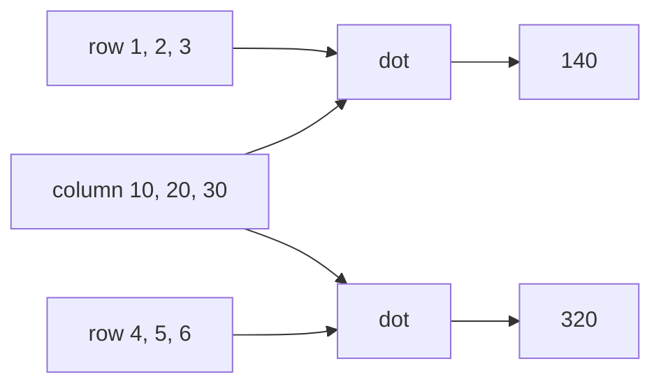
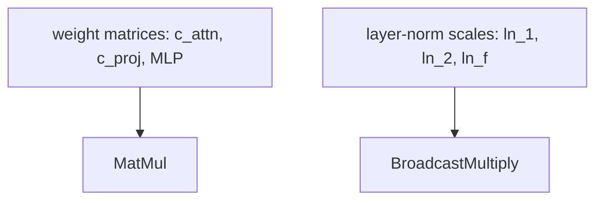
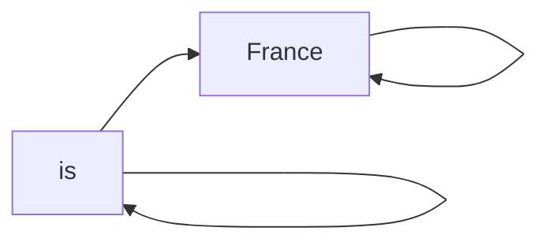
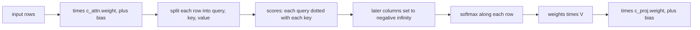
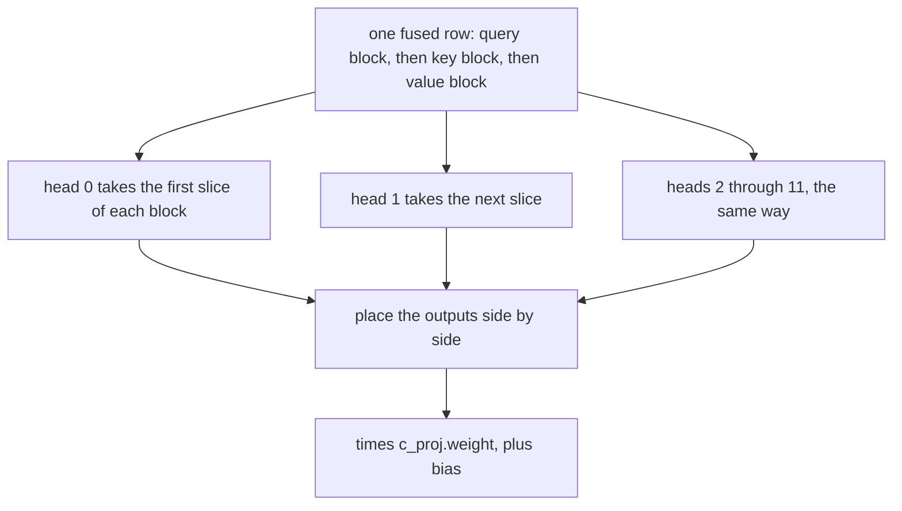
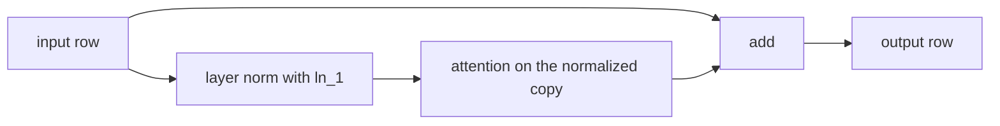
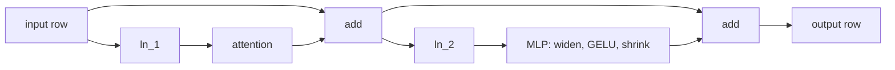

## Concepts, stage by stage

This page works through the arithmetic behind each challenge stage by hand. The stages test each piece with tiny inputs (rows that are one or two numbers wide instead of 768), so the worked examples below use those same inputs and you can check every number on paper. The same code then runs unchanged on the five real rows of "The capital of France is":

| Position | Id | Token |
| --- | --- | --- |
| 0 | 464 | `The` |
| 1 | 3139 | ` capital` |
| 2 | 286 | ` of` |
| 3 | 4881 | ` France` |
| 4 | 318 | ` is` |

Each topic maps to one package:

| Topic | Package or file |
| --- | --- |
| Reading the weights file | `internal/safetensors` |
| Tensor arithmetic | `internal/tensor` |
| Layers (linear, layer norm, GELU, mask, heads) | `internal/nn` |
| GPT-2 itself | `internal/models/gpt2` |
| Generation | `internal/generate` |
| The key-value cache | `internal/models/kv_cache`, explained in `kv-cache.md` |
| Commands | `README.md` |
| Memory and CPU measurements | `performance.md` |
| Other models | `extensions.md` |

## The weights file

`model.safetensors` is a collection of named tensors. Each tensor is stored as a flat list of numbers plus a shape that says how to read the list. A shape of `[4]` means four numbers in a line, and a shape of `[2, 3]` means two rows of three numbers. The file only stores numbers; it does not describe any of the computation.

The `inspect` command prints every tensor's name, dtype, shape, and first four values, sorted by name.

#### Bytes on disk

A safetensors file has three parts:

1. The first 8 bytes are an unsigned little-endian integer `N`, the length of the header.
2. The next `N` bytes are a JSON header with one entry per tensor.
3. Everything after the header is the raw tensor data.

For example, a file holding one tensor called `scale`, with the values `1`, `0.5`, `0.25`, and `0.125`, has this header:

```json
{
  "scale": {
    "dtype": "F32",
    "shape": [4],
    "data_offsets": [0, 16]
  }
}
```

| Field or value | Meaning |
| --- | --- |
| `data_offsets` | The tensor's byte range inside the data section (part 3). The offsets are counted from the start of the data, not from the start of the file, so the 8-byte length and the header have to be skipped first. |
| `[0, 16)` | Four float32 values at 4 bytes each. |
| `F32` | Little-endian float32. |
| `I32` | A signed integer. The engine converts it to float32 on load, so that the rest of the code only has to handle one numeric type. |
| `__metadata__` | An optional entry that is not a tensor. The loader skips it. |
| Any other dtype | The loader stops with an error. |

Running `inspect` on that file prints:

```json
[
  {
    "name": "scale",
    "dtype": "F32",
    "shape": [4],
    "first": [1.0, 0.5, 0.25, 0.125]
  }
]
```

#### How a flat list becomes rows

For a tensor with shape `[rows, columns]`, row `r` starts at index `r * columns` in the flat list. Here is a `[2, 2]` tensor:

```text
wte.weight, shape [2, 2]

index      0    1    2    3
values     1    2    3    4
           ------   ------
           row 0    row 1
```

Row 0 is `[1, 2]` and row 1 is `[3, 4]`. In GPT-2 each row is 768 numbers long, so row `r` starts at `r * 768`. The `embed` command uses `Shape[1]` as the row width for this reason; using `Shape[0]` instead is a common mistake that picks the wrong row.

#### What is inside the GPT-2 file

The stage description says the file contains 160 named tensors:

```text
model.safetensors
├── wte.weight      one row of 768 numbers for each of the 50,257 tokens
├── wpe.weight      one row of 768 numbers for each of the 1,024 positions
├── h.0.…           13 tensors for layer 0
├── h.1.…           13 tensors for layer 1, and so on up to h.11
├── ln_f.weight
└── ln_f.bias
```

Twelve of the thirteen tensors in each layer `h.N` are learned weights:

| Used by | Tensors |
| --- | --- |
| Attention | `ln_1`, `attn.c_attn`, `attn.c_proj` (each with a weight and a bias) |
| MLP | `ln_2`, `mlp.c_fc`, `mlp.c_proj` (each with a weight and a bias) |
| Final layer norm, after all twelve layers | `ln_f.weight`, `ln_f.bias` |

In the usual Hugging Face export, the thirteenth tensor is `h.N.attn.bias`. Despite its name, this tensor holds the causal mask (described in One attention head) stored as data, and nothing in it is learned. This engine builds the mask itself with `nn.CausalMask` and never reads that tensor. I took the count of 13 from the stage text and did not open the 548 MB file to confirm the name.

## From a token id to a row of numbers

A token id only names a token; the model cannot do arithmetic on it directly. `wte.weight` (word token embeddings) has one learned row per token id, and that row carries the meaning of the token but nothing about where it appears. `wpe.weight` (word position embeddings) has one learned row per position, 0 through 1,023 in GPT-2. The embedding of a token is the sum of its `wte` row and the `wpe` row for its position. This means " is" always starts from the same `wte` row wherever it appears, and its position row tells the model where in the text it is.

The embed stage sends two `[2, 2]` tables instead of the real weights, and `ids.json` is `[1, 0]`:

```text
wte.weight    1  2
              3  4

wpe.weight    10 20
              30 40
```

| Position | Id | `wte` row | `wpe` row | Sum |
| --- | --- | --- | --- | --- |
| 0 | 1 | row 1, `[3, 4]` | row 0, `[10, 20]` | `[13, 24]` |
| 1 | 0 | row 0, `[1, 2]` | row 1, `[30, 40]` | `[31, 42]` |

`embed` prints `[[13, 24], [31, 42]]`.

## Two kinds of multiplication

GPT-2 multiplies by its weights in two different ways, and the engine has a separate function for each. The README's What I learned section explains why I split them.

| Kind | Weights | Function | What it does |
| --- | --- | --- | --- |
| Matrix product | `c_attn`, `c_proj`, the MLP's `c_fc` and `c_proj` | `tensor.MatMul` | Combines each input row with the whole weight matrix. |
| Per-column scale | `ln_1.weight`, `ln_2.weight`, `ln_f.weight` | `tensor.BroadcastMultiply` | Multiplies each column by its own number, the same way for every row. |
| Bias | `c_attn.bias`, `c_proj.bias`, `ln_1.bias`, and the other biases | `tensor.Add` | Adds the same vector to every row. |

All of these clone the values before writing, so the caller's tensor is never modified. The README's What I learned section explains why this matters with Go value receivers.

#### Matrix product

Each entry of a matrix product is the dot product of a row from the left matrix with a column from the right matrix. The result has as many rows as the left matrix and as many columns as the right one. This is the product that turns the row for " is" into its query, key, and value. The stage checks it with a `[2, 3]` matrix and the column `10, 20, 30`:

$$
\begin{bmatrix}
1 & 2 & 3 \\
4 & 5 & 6
\end{bmatrix}
\begin{bmatrix}
10 \\ 20 \\ 30
\end{bmatrix}
=
\begin{bmatrix}
1\cdot 10 + 2\cdot 20 + 3\cdot 30 \\
4\cdot 10 + 5\cdot 20 + 6\cdot 30
\end{bmatrix}
=
\begin{bmatrix}
140 \\
320
\end{bmatrix}
$$



A single token, such as " is" on its own, is the same product with only one row on the left:

$$
\begin{bmatrix} 1 & 2 \end{bmatrix}
\begin{bmatrix} 3 & 4 \\ 5 & 6 \end{bmatrix}
=
\begin{bmatrix} 1\cdot 3 + 2\cdot 5 & 1\cdot 4 + 2\cdot 6 \end{bmatrix}
=
\begin{bmatrix} 13 & 16 \end{bmatrix}
$$

#### Per-column scale

`tensor.BroadcastMultiply` takes a list with one number per column and multiplies every row by it, column by column. With the list `[10, 20, 30]` (stored with shape `[3]`):

```text
1  2  3      10  20  30      10   40   90
4  5  6   *  10  20  30   =  40  100  180
```



## One attention head

After embedding, the row for " is" is 768 numbers that describe the token " is" at position 4, and nothing else. It contains no information about "The" or "France". Attention is the step that lets each position gather information from the positions before it. It replaces each row with a weighted average of that row and all the earlier rows, where the weights are learned from how relevant each earlier token is. A position is never allowed to look at later positions, because during generation those tokens do not exist yet.

As an example, here are the weights one head in a later layer of GPT-2 gives when computing the new row for " is":

| The | capital | of | France | is |
| --- | --- | --- | --- | --- |
| 0.347 | 0.017 | 0.007 | 0.571 | 0.058 |

More than half of the new row comes from "France", which is the token most useful for predicting what follows "The capital of France is".

#### Queries, keys, and values

Each row is projected into three vectors:

| Vector | Role |
| --- | --- |
| Query | Describes what this position is looking for. |
| Key | Describes what this position offers, so that other positions' queries can be compared against it. |
| Value | The information this position contributes to the average when it is attended to. |

The score between position `i` and position `j` is the dot product of query `i` with key `j`, divided by the square root of the vector length `d`:

$$
\mathrm{score}_{ij} = \frac{q_i \cdot k_j}{\sqrt{d}}
$$

The division is needed because a dot product of longer vectors tends to be larger, even for an equally good match. Without it, scores for 768-wide vectors would be much larger than scores for 1-wide vectors, and softmax would put almost all of the weight on a single position.

#### Softmax

Softmax turns one row of scores into weights that are all positive and add up to 1:

$$
\mathrm{weight}_i = \frac{e^{z_i - z_{\max}}}{\sum_j e^{z_j - z_{\max}}}
$$

Because of the exponential, differences between scores are magnified: a score that is 2 higher than another gets about `e^2`, roughly 7 times, the weight. The code subtracts the largest score in the row before calling `exp`. This does not change the weights, because the same factor cancels out of the top and the bottom of the fraction, but it stops `exp` from overflowing on large scores.

#### The causal mask

Before softmax, each score where `j > i` (a later position) is set to negative infinity. Since `exp` of negative infinity is 0, those positions get a weight of exactly 0. For "France" followed by "is", "France" can only use itself, while "is" can use both "France" and itself:



The whole head, from the input rows to the output:



#### Worked example from the stage

The single-head stage sets `n_embd` to 1, so every row is one number instead of 768. The input is `[[1], [2]]`, with shape `[2, 1]`. `c_attn.weight` has shape `[1, 3]` and is filled with ones, and `c_attn.bias` is `[0, 0, 0]`. Multiplying by that weight copies each input number into the query, the key, and the value:

$$
\begin{bmatrix} 1 \\ 2 \end{bmatrix}
\begin{bmatrix} 1 & 1 & 1 \end{bmatrix}
=
\begin{bmatrix}
1 & 1 & 1 \\
2 & 2 & 2
\end{bmatrix}
$$

The bias has length 3 and would be added to every row, but here it is all zeros.

```text
position 0    query 1    key 1    value 1
position 1    query 2    key 2    value 2
```

Dividing by `sqrt(1)` changes nothing. The matrix on the left holds the scores, with the masked later column set to negative infinity, and the matrix on the right holds the weights after softmax:

$$
\begin{bmatrix}
1 & -\infty \\
2 & 4
\end{bmatrix}
\xrightarrow{\text{softmax}}
\begin{bmatrix}
1 & 0 \\
0.119 & 0.881
\end{bmatrix}
$$

Position 0 has only one score that is not masked, so all of its weight goes to itself, and its output is `1 * 1 = 1`.

Position 1 has the scores 2 and 4:

```text
exp(2) = 7.389056
exp(4) = 54.598150
sum    = 61.987206

weights   7.389056 / 61.987206 = 0.119203
          54.598150 / 61.987206 = 0.880797

new value 0.119203 * 1 + 0.880797 * 2 = 1.880797
```

That weighted sum is the same thing as multiplying the weight matrix by the column of values. A `[2, 2]` matrix times a `[2, 1]` matrix gives a `[2, 1]` result:

$$
\begin{bmatrix}
1 & 0 \\
0.119203 & 0.880797
\end{bmatrix}
\begin{bmatrix} 1 \\ 2 \end{bmatrix}
=
\begin{bmatrix}
1\cdot 1 + 0\cdot 2 \\
0.119203\cdot 1 + 0.880797\cdot 2
\end{bmatrix}
=
\begin{bmatrix} 1 \\ 1.880797 \end{bmatrix}
$$

`c_proj.weight` is `[[1]]` and `c_proj.bias` is `[0]`, so the final projection leaves both numbers unchanged, and `attn` prints `[[1.0], [1.8807970779778822]]`.

One detail that tripped me up: `n_positions` in the config is the longest input the model was built for (4 in this stage, 1,024 in GPT-2), not the number of rows in the current input. The number of rows to process is `inputTensor.Shape[0]`.

## Multi-head attention

A single head tends to focus on one kind of relationship. The head above puts 0.571 of its weight on "France" when computing " is", and only 0.017 on "capital". GPT-2 runs 12 heads in parallel on the same rows, so that different heads can follow different relationships. For comparison, here is a second head in the same layer, also computing " is":

| The | capital | France |
| --- | --- | --- |
| 0.633 | 0.236 | 0.047 |

This head pays much more attention to "capital" than the first one does.

Each head works on its own slice of the query, key, and value. Their outputs are placed side by side, which makes the row 768 numbers wide again, and then `c_proj` mixes them together.



| Item | Value |
| --- | --- |
| `n_head` | Read from `config.json`. |
| Slice width (`head_dim`) | `n_embd / n_head`. |
| GPT-2 | 768 and 12, so each slice is 64 numbers wide, and the score divides by `sqrt(64)`. |
| The single-head stage | The whole row was one slice, so the score divided by the square root of the full row width. |
| `c_attn.weight` | Shape `[n_embd, 3 * n_embd]`. It runs once for all heads, before the row is split. |
| Head 0 | Takes the first `head_dim` columns of the query block, the key block, and the value block. |
| Head 1 | Takes the next `head_dim` columns of each block, and so on. |
| `nn.SplitHeads` | Copies each head's columns out. |
| `nn.MergeHeads` | Joins the heads' outputs back together. |

#### Worked example from the stage

The two-head stage sets `n_embd` to 2 and `n_head` to 2, so each head is one number wide. The input is two rows:

$$
\begin{bmatrix}
1 & 0 \\
0 & 1
\end{bmatrix}
$$

The weights make each fused row the input row repeated three times: position 0 becomes `1, 0, 1, 0, 1, 0` and position 1 becomes `0, 1, 0, 1, 0, 1`. In the layout below, the vertical bars separate the query, key, and value blocks, and inside each block the first number belongs to head 0 and the second to head 1:

$$
\begin{array}{cc|cc|cc}
q_0 & q_1 & k_0 & k_1 & v_0 & v_1 \\
\hline
1 & 0 & 1 & 0 & 1 & 0 \\
0 & 1 & 0 & 1 & 0 & 1
\end{array}
$$

Splitting that by head gives:

```text
head 0                         head 1
pos 0    Q 1   K 1   V 1       pos 0    Q 0   K 0   V 0
pos 1    Q 0   K 0   V 0       pos 1    Q 1   K 1   V 1
```

Position 0 can only see itself, so both heads give it a weight of 1 on itself, and its output stays `[1, 0]`.

For position 1 in head 0, the query is 0 and the keys are 1 and 0, so both scores are 0. Softmax of two equal scores is `[0.5, 0.5]`. The values are 1 and 0, so the output is `0.5 * 1 + 0.5 * 0 = 0.5`.

For position 1 in head 1, the query is 1 and the keys are 0 and 1, so the scores are 0 and 1:

```text
exp(0) = 1
exp(1) = 2.718282
sum    = 3.718282

weights   1 / 3.718282         = 0.268941
          2.718282 / 3.718282  = 0.731059

values in this head are 0, then 1
average   0.268941 * 0 + 0.731059 * 1 = 0.731059
```

Placing the two heads' outputs side by side gives `[0.5, 0.731059]` for position 1. `c_proj` leaves the rows unchanged, and `attn` prints `[[1.0, 0.0], [0.5, 0.7310585786300049]]`.

## Residual connections and layer norm

A transformer block does not replace its input with the attention output. It adds the attention output back onto the input, so the original information about the token is kept and attention only contributes a correction. This addition is called a residual connection. GPT-2 stacks 12 of these blocks.



The arrow that goes around layer norm and attention is the residual. Attention works on a normalized copy of the row, while the addition uses the original row from before normalization.

#### Layer norm

Layer norm rescales a row so that its numbers have a mean of 0 and a standard deviation of about 1. It then multiplies each column by `ln_1.weight` and adds `ln_1.bias`, using the per-column scale described in Two kinds of multiplication. The mean and the population variance are computed over the numbers in that one row. `nn.LayerNorm` applies the epsilon from the config along with the weight and bias:

$$
\operatorname{layernorm}(x) = \frac{x - \mathrm{mean}}{\sqrt{\mathrm{variance} + 0.00001}} \cdot \mathrm{weight} + \mathrm{bias}
$$

The multiplication by `weight` is the per-column scale. `0.00001` is GPT-2's `layer_norm_epsilon`, which stops the division from blowing up when the variance is close to zero. Note that the epsilon goes inside the square root.

The reason for normalizing is that it makes the block's input independent of the overall scale of the row. A row and the same row multiplied by ten come out almost identical. Take `[2, 4, 6, 8]`:

| | `[2, 4, 6, 8]` | `[20, 40, 60, 80]` |
| --- | --- | --- |
| Mean | 5 | 50 |
| Deviations from the mean | `-3, -1, 1, 3` | `-30, -10, 10, 30` |
| Variance | `(9 + 1 + 1 + 9) / 4 = 5` | 500, which is 100 times larger |
| After dividing by `sqrt(variance + 0.00001)` | about `-1.34, -0.45, 0.45, 1.34` | the same values, because the square root is 10 times larger, which cancels the 10 times larger deviations |

#### Worked example from the stage

The block stage sends `[[1, 2]]`: one token with a row two numbers wide. `ln_1.weight` is `[1, 1]` and `ln_1.bias` is `[0, 0]`. The attention weights copy the row into its query, key, and value, and since there is only one position, attention returns that row unchanged.

```text
mean         (1 + 2) / 2 = 1.5
variance     (0.5^2 + 0.5^2) / 2 = 0.25
scale        sqrt(0.25 + 0.00001) = sqrt(0.25001) ≈ 0.50001
normalized   -0.5 / 0.50001 ≈ -0.99998
              0.5 / 0.50001 ≈  0.99998
multiplying by [1, 1] and adding [0, 0] leaves the row as it is

attention    about [-1, 1]
output       [1, 2] + [-1, 1] = about [0, 3]
```

The exact first number is about `1.99994e-05`, which the tester accepts as 0 because it is within its `0.0001` tolerance. At the precision the stage prints, the result of this half of the block is `[[0.0, 3.0]]`.

`gpt2.Model.Block` then continues with the second half: `ln_2`, the MLP, and the second residual connection, described next.

## The MLP

After attention has mixed information between positions, the MLP (multi-layer perceptron) processes each row on its own, including the row for " is". Most of a block's parameters are in the MLP.

| Step | What happens |
| --- | --- |
| Widen | A matrix product takes the row from `n_embd` to `4 * n_embd` numbers. In GPT-2, 768 becomes 3,072. |
| GELU | A non-linear function is applied to every number. Negative numbers are pushed towards 0, and positive numbers stay close to their original value. |
| Shrink | A second matrix product brings the row back to `n_embd` numbers. |
| Add | The result is added back onto the MLP's input. This is the second residual connection, the same pattern as for attention. |

The complete block:



Without the GELU in the middle, the widen and shrink steps would combine into a single matrix product, and the MLP could only learn linear functions. GELU is what lets it learn more complicated ones.

#### Which GELU to use

GPT-2, and therefore the tester, uses the tanh approximation of GELU:

$$
\operatorname{gelu}(x) = 0.5 \cdot x \cdot \left(1 + \tanh\left(\sqrt{\frac{2}{\pi}}\left(x + 0.044715 \cdot x^{3}\right)\right)\right)
$$

The exact GELU, defined with the error function, differs from this approximation by up to about `0.0005`. That is larger than the tester's `0.0001` tolerance, so the exact version fails the stage. I measured the largest difference as `0.00047` by evaluating both formulas at every multiple of `0.001` between `-6` and `6`.

These articles explain GELU and how it compares to other activation functions:

- [GELU activation function explained (Analytics Vidhya)](https://www.analyticsvidhya.com/blog/2026/10/gelu-activation-function-explained/)
- [Is GELU the ReLU successor? (Towards AI)](https://pub.towardsai.net/is-gelu-the-relu-successor-deep-learning-activations-7506cf96724f)
- [GELU activation function (jacar.es)](https://jacar.es/en/gelu-activation-function/)

#### Worked example from the stage

Continuing the `[[1, 2]]` block: after the first residual connection the row is about `[0, 3]`. `ln_2`, with weight `[1, 1]` and bias `[0, 0]`, normalizes it to about `[-1, 1]`. The widen step in this stage keeps those two numbers and fills the other six with zeros, so GELU receives `[-1, 1, 0, 0, 0, 0, 0, 0]`.

| Input | GELU output |
| --- | --- |
| `-1` | about `-0.1588` |
| `1` | about `0.8412` |
| `0` | `0` |

The shrink step returns the first two numbers to their places, and they are added onto `[0, 3]`:

```text
[0, 3] + [-0.1588, 0.8412] = [-0.1588, 3.8412]
```

The stage prints `[[-0.15878819, 3.84116958]]`.

## When the numbers look wrong

| What you see | What is causing it |
| --- | --- |
| `inspect` shows an unexpected shape, or `first` is a mix of huge and tiny values | Reading started at the wrong byte. `data_offsets` are counted from the start of the data section, which comes after the 8-byte length and the JSON header. |
| An embedding row has the right width but belongs to the wrong token | The row was located with `id * Shape[0]`, or the slice was allocated with `Shape[0]` numbers. A row is `Shape[1]` numbers long and starts at `id * Shape[1]`. |
| Attention reports `n_pos: 4` when the input has 2 rows | The number of positions was taken from `n_positions` in the config. The number of rows in the current input is `inputTensor.Shape[0]`. |
| A one-column attention result is about `1.88` on the second row | This is the expected single-head answer: scores 2 and 4 become weights of about `0.119` and `0.881`, and `0.119 * 1 + 0.881 * 2` is about `1.88`. |
| Two-head output is `[[1, 0], [0.5, 0.73]]` | This is the expected two-head answer. Head 0 splits two equal scores into `[0.5, 0.5]`, head 1 splits scores 0 and 1 into about `[0.269, 0.731]`, and the divisor is `sqrt(1)` because each head is one number wide. |
| A one-token projection has the shape of the weight matrix, and each column looks scaled | The projection used `tensor.BroadcastMultiply`. `c_proj.weight` is a matrix and needs `tensor.MatMul`. |
| The block on `[[1, 2]]` prints about `[[0, 3]]` | This is the expected result of the first half of the block: layer norm turns `[1, 2]` into about `[-1, 1]`, attention on one row returns it unchanged, and the residual adds it to `[1, 2]`. |
| Layer norm is far off on a row whose numbers are almost equal | Layer norm divided by `sqrt(variance) + eps` instead of `sqrt(variance + eps)`. On `[1, 2]` the two give almost the same result, but when the variance is close to zero the first is much smaller and the output blows up. |
| The full block on `[[1, 2]]` gives about `[-0.159, 3.841]` | This is the expected full-block result: `ln_2` produces about `[-1, 1]`, GELU turns those into about `-0.1588` and `0.8412`, and the pair is added onto `[0, 3]`. |
| The full block is off by a few ten-thousandths | The MLP used the exact (error function) GELU instead of the tanh approximation. |
