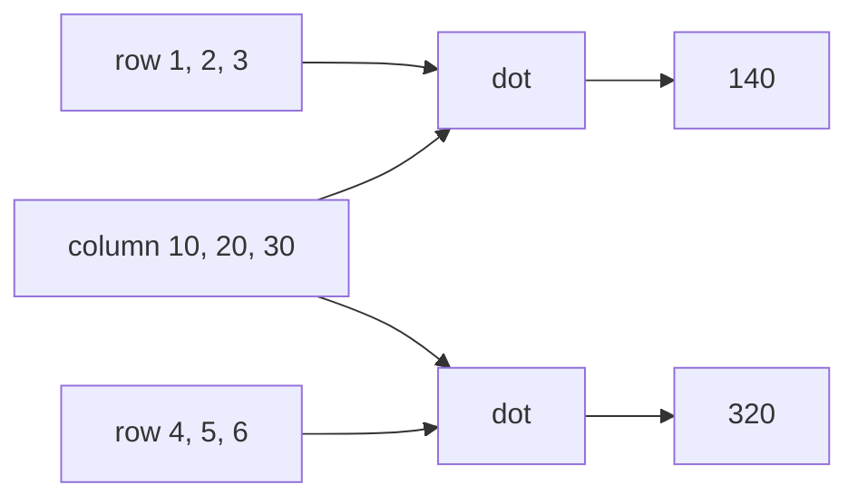
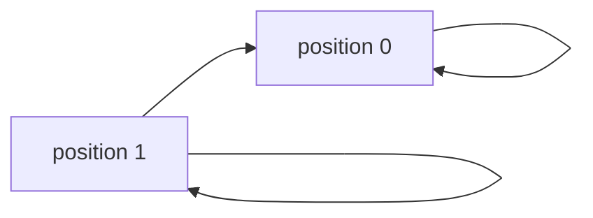
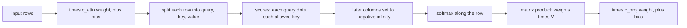
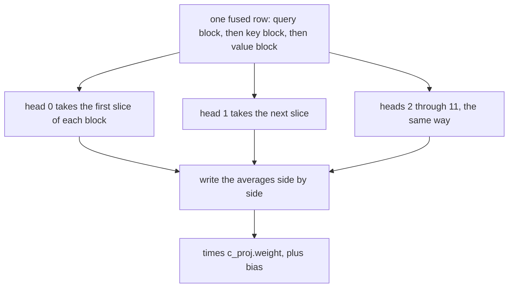
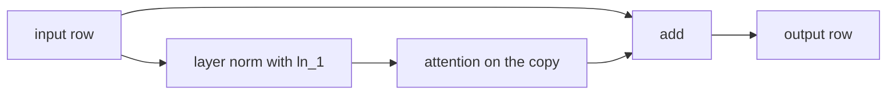
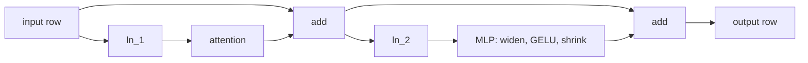

These notes follow the stages this repository already implements: the weight file, embeddings, one attention head, many heads, then layer norm and the residual add. Every example is small enough to finish on paper. The byte layout was checked against `app/safetensors.go`. The arithmetic was checked against the stage examples and against `app/embed.go`, `app/attention.go`, and `app/tensor.go` on 22 November 2026. The matching Go for the row-copy lives in `README.md`, under Broadcasting.

## The file of weights

An inference engine is the program that runs a model someone else already trained. GPT-2 shows up as one file, `model.safetensors`. Inside it are named tables of numbers. Each table is a tensor: a flat list, plus a shape that tells you how to fold the list. Shape `[4]` is four numbers in a single line. Shape `[2, 3]` is six numbers, folded into two rows of three.

The file itself does no arithmetic. `inspect` prints what the loader actually found: the name, the kind of number, the shape, and the first four values (or all of them, when the tensor is shorter than that). Names come out in alphabetical order. When a later command prints a surprising row, this is the command that shows you the table you really loaded.

#### Bytes on disk

The loader walks the file in three steps:

1. Read 8 bytes as an unsigned integer, little-endian. Call that integer `N`. It is the length of the header that follows.
2. Read the next `N` bytes and parse them as JSON. There is one entry per tensor.
3. Everything after the JSON is the raw numbers.

A tensor named `scale`, holding `1`, `0.5`, `0.25`, and `0.125`, has a header entry like this:

```json
{
  "scale": {
    "dtype": "F32",
    "shape": [4],
    "data_offsets": [0, 16]
  }
}
```

`data_offsets` is measured from the first byte of step 3. The 8-byte length and the JSON sit in front of that byte, so they are outside the offset. One float32 is 4 bytes, and four of them fill bytes `[0, 16)` of the data region. The loader reads each group of 4 bytes as a little-endian `F32`. An `I32` tensor is read as a signed integer and then stored as a float32, so the rest of the engine only has to add and multiply one kind of number. A header key named `__metadata__` is skipped. Any other dtype stops the load with an error.

`inspect` on that file prints:

```json
[
  {
    "name": "scale",
    "dtype": "F32",
    "shape": [4],
    "first": [1.0, 0.5, 0.25, 0.125]
  }
]
```

#### How a flat list becomes rows

Numbers are packed one row after another. For shape `[rows, columns]`, row `r` starts at index `r * columns`.

```text
wte.weight, shape [2, 2]

index      0    1    2    3
values     1    2    3    4
           ------   ------
           row 0    row 1
```

Row 0 is `[1, 2]`. Row 1 is `[3, 4]`. A real GPT-2 row is 768 numbers long, so row `r` starts at index `r * 768`. The lookup in `embed` uses that width, `Shape[1]`.

#### What sits in the GPT-2 file

The stage description counts 160 named tables. Two of them turn token ids into rows. Two more are a final layer norm that runs after the whole stack:

```text
model.safetensors
├── wte.weight      one row of 768 numbers for each of 50,257 tokens
├── wpe.weight      one row of 768 numbers for each of 1,024 positions
├── h.0.…           13 tables for layer 0
├── h.1.…           13 tables for layer 1, and so on through h.11
├── ln_f.weight
└── ln_f.bias
```

Twelve tables under each `h.N` are learned weights. Attention uses `c_attn`, `c_proj`, and `ln_1`. The wide middle of the block uses `ln_2` and `mlp`. The thirteenth table, in the usual Hugging Face export, is `h.N.attn.bias`, a causal mask stored as data. This engine builds that mask in `applyCausalMask` and leaves the stored table unread. The 548 MB file was not opened to confirm the name. The count of 13 comes from the stage text.

GPT-2 reads token ids. The prompt "The capital of France is" is the ids `[464, 3139, 286, 4881, 318]`. Once the later stages exist, generation embeds those ids, runs the stack, scores every token in the vocabulary, picks one, and feeds that id back in.

## From an id to a row

An id only names a token. You cannot multiply "4881" by a weight in any way that means "France". `wte.weight` holds the learned description of each id, one row per id. That row still has no idea where the token sits in the sentence, so `wpe.weight` holds a second learned row for each position, from 0 through 1,023 in the real model. The embedding is those two rows added, number by number. The same word later in the prompt keeps its `wte` row and picks up a different `wpe` row, and the sum changes.

The stage uses two tiny tables, both shape `[2, 2]`:

```text
wte.weight    1  2
              3  4

wpe.weight    10 20
              30 40
```

`ids.json` is `[1, 0]`. The first position wants token 1. The second position wants token 0.

```text
position 0, id 1     wte row 1 [3, 4]  +  wpe row 0 [10, 20]  =  [13, 24]
position 1, id 0     wte row 0 [1, 2]  +  wpe row 1 [30, 40]  =  [31, 42]
```

`embed` prints `[[13, 24], [31, 42]]`.

## What multiply does

> Note. GPT-2, and the models that keep this block, use two different multiplies. The internal weights (`c_attn`, `c_proj`, and the MLP matrices `c_fc` and `c_proj`) are matrix products: a row is combined with a whole matrix. Layer-norm scales (`ln_1.weight`, `ln_2.weight`, `ln_f.weight`) are vectors, one number per column, copied onto every token and multiplied in place. Biases are the same shape of vector, added rather than multiplied. `matmul` does the matrix product. `broadcastMultiply` does the per-column scale. `add` stays one function, because addition has only the broadcast.

`matmul` is the matrix product. That is the call used for `c_attn.weight`, `c_proj.weight`, a query times a transposed key, and the attention weights times `V`. Each entry of the result is a dot product along the shared side. The result has the left tensor's height and the right tensor's width.

Take a `[2, 3]` matrix and stand the list `10, 20, 30` up as a column of shape `[3, 1]`. Inner size 3 matches inner size 3, so this is a product, and the answer is one number per row:

```math
\begin{bmatrix}
1 & 2 & 3 \\
4 & 5 & 6
\end{bmatrix}
\begin{bmatrix}
10 \\ 20 \\ 30
\end{bmatrix}
=
\begin{bmatrix}
1\cdot 10 + 2\cdot 20 + 3\cdot 30 \\
4\cdot 10 + 5\cdot 20 + 6\cdot 30
\end{bmatrix}
=
\begin{bmatrix}
140 \\
320
\end{bmatrix}
```



A one-token prompt is the same kind of product. The left side has a single row, and it still dots with each column of the weight:

```math
\begin{bmatrix} 1 & 2 \end{bmatrix}
\begin{bmatrix} 3 & 4 \\ 5 & 6 \end{bmatrix}
=
\begin{bmatrix} 1\cdot 3 + 2\cdot 5 & 1\cdot 4 + 2\cdot 6 \end{bmatrix}
=
\begin{bmatrix} 13 & 16 \end{bmatrix}
```


The column scale is `broadcastMultiply`. A list has no second dimension, so it is laid across every row and each column is scaled by its own entry. Stored as shape `[3]`, those same numbers scale the matrix like this:

```text
1  2  3      10  20  30      10   40   90
4  5  6   *  10  20  30   =  40  100  180
```

`add` copies a bias with that same row stamp, then adds. `c_attn.bias`, `c_proj.bias`, and `ln_1.bias` are those lists. The caller's tensor is left alone in both branches: the function clones the values before it writes.

## One head of attention

After embedding, the row for "is" only knows that the token is "is". It has not been told which capital was just named. Attention builds a new row as a weighted average of this row and the earlier rows. A position cannot see rows that come later, because those tokens have not been written yet. In a later layer of the real model, one head gives "is" these weights: "The" 0.347, "capital" 0.017, "of" 0.007, "France" 0.571, "is" 0.058. More than half of the new row is borrowed from "France".

Who may look at whom, for a two-token prompt:



Position 0 has only itself. Position 1 may use position 0 and itself. There is no arrow from position 0 to position 1.

Each row is turned into three lists. The query is what this position is looking for. The key is how this position describes itself, so that someone else's query can match it. The value is the content this position hands over when it is chosen. The score between position `i` and position `j` is the dot product of query `i` with key `j`, divided by the square root of the length of those lists. A longer list makes a larger dot product for the same kind of match. A huge score makes the next step put almost all of the weight on one position. Dividing by the square root keeps the scores in a similar range when the lists grow from the toy width of 1 to GPT-2's 768.

```math
\mathrm{score}_{ij} = \frac{q_i \cdot k_j}{\sqrt{d}}
```

Softmax turns one row of scores into weights that add up to 1. The code subtracts the largest score in the row before calling `exp`. The weights come out the same, and `exp` of a large number does not overflow. A score that leads another by 2 gets about `e^2`, roughly 7 times the weight.

```math
\mathrm{weight}_i = \frac{e^{z_i - z_{\max}}}{\sum_j e^{z_j - z_{\max}}}
```

The whole head, from the input row to the projected row:



The toy stage sets `n_embd` to 1, so every row is a single number. The input is `[[1], [2]]`, shape `[2, 1]`. `c_attn.weight` is shape `[1, 3]`, filled with ones, and `c_attn.bias` is `[0, 0, 0]`. The weight multiply is the matrix product above: each input number is dotted with each column of ones, which copies it into the query, the key, and the value.

```math
\begin{bmatrix} 1 \\ 2 \end{bmatrix}
\begin{bmatrix} 1 & 1 & 1 \end{bmatrix}
=
\begin{bmatrix}
1 & 1 & 1 \\
2 & 2 & 2
\end{bmatrix}
```

The bias is a 1D list of length 3, so it takes the column-scale path and is added to every row. Here every entry is zero.

```text
position 0    query 1    key 1    value 1
position 1    query 2    key 2    value 2
```

Dividing by `sqrt(1)` changes nothing. The score matrix, with the forbidden later column written as negative infinity, is on the left. Softmax of a row that contains negative infinity gives that column weight 0, because `exp` of it is 0.

```math
\begin{bmatrix}
1 & -\infty \\
2 & 4
\end{bmatrix}
\xrightarrow{\text{softmax}}
\begin{bmatrix}
1 & 0 \\
0.119 & 0.881
\end{bmatrix}
```

Position 0 has one finite score, so its weight on itself is 1 and its new value is `1 * 1 = 1`.

Position 1 has scores 2 and 4:

```text
exp(2) = 7.389056
exp(4) = 54.598150
sum    = 61.987206

weights   7.389056 / 61.987206 = 0.119203
          54.598150 / 61.987206 = 0.880797

new value 0.119203 * 1 + 0.880797 * 2 = 1.880797
```

That weighted sum is the matrix product of the weight matrix with the value column, not a square-by-square multiply. Shape `[2, 2]` times shape `[2, 1]` is shape `[2, 1]`:

```math
\begin{bmatrix}
1 & 0 \\
0.119203 & 0.880797
\end{bmatrix}
\begin{bmatrix} 1 \\ 2 \end{bmatrix}
=
\begin{bmatrix}
1\cdot 1 + 0\cdot 2 \\
0.119203\cdot 1 + 0.880797\cdot 2
\end{bmatrix}
=
\begin{bmatrix} 1 \\ 1.880797 \end{bmatrix}
```

`c_proj.weight` is `[[1]]` and `c_proj.bias` is `[0]`, so the last matrix product leaves both numbers as they are. `attn` prints `[[1.0], [1.8807970779778822]]`.

`n_positions` in the config is the longest prompt the model was sized for: 4 in this toy, 1,024 in GPT-2. The rows in front of you are `inputTensor.Shape[0]`. A short prompt has fewer rows than that maximum.

## Twelve looks at once

One head spends most of its weight on one relationship. The head above puts 0.571 on "France", and "capital" is left with 0.017. GPT-2 runs 12 heads over the same rows, each with its own slice of the query, the key, and the value. A second head in that same layer puts 0.633 on "The", 0.236 on "capital", and only 0.047 on "France". Each head averages the values with its own weights. The averages are written next to each other, and the row is 768 numbers wide again.



`n_head` comes from `config.json`. One slice is `n_embd / n_head` numbers wide. GPT-2 uses 768 and 12, so a slice is 64 wide. The score divides by the square root of that slice width. The single-head stage divided by the square root of the whole row, because the whole row was the slice.

`c_attn` still runs once, before the split. Its weight has shape `[n_embd, 3 * n_embd]`. One input row times that matrix is the three blocks in a line. Inside each block the heads also sit in a line. Head 0 owns the first `head width` columns. Head 1 owns the next band. `sliceHead` copies that band out of every row.

The toy here has `n_embd` 2 and `n_head` 2, so each head is one number wide. The weights copy the input into the query, the key, and the value. The input is:

```math
\begin{bmatrix}
1 & 0 \\
0 & 1
\end{bmatrix}
```

Position 0's fused row is then `1, 0` three times, and position 1's fused row is `0, 1` three times. The vertical bars split query, key, and value. Inside a block, the first number is head 0 and the second number is head 1.

```math
\begin{array}{cc|cc|cc}
q_0 & q_1 & k_0 & k_1 & v_0 & v_1 \\
\hline
1 & 0 & 1 & 0 & 1 & 0 \\
0 & 1 & 0 & 1 & 0 & 1
\end{array}
```

Reading down one head's column:

```text
head 0                         head 1
pos 0    Q 1   K 1   V 1       pos 0    Q 0   K 0   V 0
pos 1    Q 0   K 0   V 0       pos 1    Q 1   K 1   V 1
```

Position 0 can only see itself, so each head gives it weight 1. Its output stays `[1, 0]`.

Position 1, head 0. The query is 0. The keys are 1, then 0. Both scores are 0. Softmax of two equal scores is `[0.5, 0.5]`. The values in this column are 1 and 0, so the average is `0.5 * 1 + 0.5 * 0 = 0.5`.

Position 1, head 1. The query is 1. The keys are 0, then 1. The scores are 0 and 1.

```text
exp(0) = 1
exp(1) = 2.718282
sum    = 3.718282

weights   1 / 3.718282         = 0.268941
          2.718282 / 3.718282  = 0.731059

values in this column are 0, then 1
average   0.268941 * 0 + 0.731059 * 1 = 0.731059
```

The two averages sit side by side as `[0.5, 0.731059]`. `c_proj` in this example leaves the row unchanged. `attn` prints `[[1.0, 0.0], [0.5, 0.7310585786300049]]`.

## Keeping the word and the context

The average replaces the row. "is" kept only 0.058 of itself, so the row now knows the sentence is about France and has nearly forgotten that this token is the word "is". A block adds attention's output back onto the row it started from. The original numbers remain in the sum, with whatever attention found added on top. GPT-2 is 12 of these blocks, one after another.



The arrow that skips layer norm is the residual. Attention sees the normalized copy. The add sees the row from before that copy was made.

Repeated adds make the numbers grow, so each block first rescales a copy. After the rescaling, the copy has mean 0 and standard deviation about 1. Then `ln_1.weight` scales each column and `ln_1.bias` shifts each column, using the row copy from the broadcasting section. A row and that same row times ten come out almost the same, which is why the growing numbers stop being a problem. Take `[2, 4, 6, 8]`. The mean is 5. The deviations are `-3, -1, 1, 3`. The variance is the average of the squared deviations, `(9 + 1 + 1 + 9) / 4 = 5`. Dividing by `sqrt(5 + 0.00001)` gives about `-1.34, -0.45, 0.45, 1.34`. The row `[20, 40, 60, 80]` has deviations ten times larger and a variance 100 times larger, so the square root is ten times larger and the quotients match.

```math
\mathrm{layer\_norm}(x) = \frac{x - \mathrm{mean}}{\sqrt{\mathrm{variance} + 0.00001}} \cdot \mathrm{weight} + \mathrm{bias}
```

> Note. The dot in that formula is the broadcast multiply: one scale per column, copied onto every token. The matrix product used for `c_attn.weight` and the other internal weights is the other path, under What multiply does.

`0.00001` is GPT-2's own `layer_norm_epsilon`. The mean and the variance are taken over the numbers in that one row. A comment in `layerNorm` calls the variance unbiased. The code divides by the row length, which is the formula above. Weight and bias are applied after `layerNorm` returns.

The toy input is `[[1, 2]]`. `ln_1.weight` is `[1, 1]` and `ln_1.bias` is `[0, 0]`. Attention's weights copy a row into its query, key, and value. There is only one position, so attention returns that row unchanged.

```text
mean         (1 + 2) / 2 = 1.5
variance     (0.5^2 + 0.5^2) / 2 = 0.25
scale        sqrt(0.25 + 0.00001) = sqrt(0.25001) ≈ 0.50001
normalized   -0.5 / 0.50001 ≈ -0.99998
              0.5 / 0.50001 ≈  0.99998
times [1, 1] and plus [0, 0] leaves that row

attention    about [-1, 1]
output       [1, 2] + [-1, 1] = about [0, 3]
```

The precise first number is about `1.99994e-05`. The tester accepts that as `0` within a tolerance of `0.0001`. At the precision the stage prints, `block` shows `[[0.0, 3.0]]`.

`calculateBlock` returns at this add. The second half of the block, `ln_2` and the MLP, is the next stage. Those tensors are in the file, and this function does not read them yet.

## The wide middle of the block

Attention carries information from one row to another. The MLP works on each row alone and never looks at a neighbor. It holds most of the numbers in a block. The first matrix widens the row from `n_embd` to `4 * n_embd` (768 becomes 3,072 in GPT-2). GELU then pulls negative numbers toward 0 and leaves positive numbers near themselves. The second matrix brings the row back to `n_embd`. The same skip-and-add wraps this half:



The GELU the tester scores is the tanh approximation. An exact GELU can differ by about `0.0005`, which is enough to fail.

```math
\mathrm{gelu}(x) = 0.5 \, x \, \left(1 + \tanh\left(\sqrt{\frac{2}{\pi}}\left(x + 0.044715 \, x^{3}\right)\right)\right)
```

Continue the `[[1, 2]]` block. After the first residual add the row is about `[0, 3]`. `ln_2`, with weight `[1, 1]` and bias `[0, 0]`, normalizes it to about `[-1, 1]` again. The toy widen-step keeps those two numbers and fills the rest of the wide row with zeros, so GELU sees `[-1, 1, 0, 0, 0, 0, 0, 0]`. `gelu(-1)` is about `-0.1588`, `gelu(1)` is about `0.8412`, and `gelu(0)` is 0. The shrink-step puts the first two numbers back, and they are added onto `[0, 3]`:

```text
[0, 3] + [-0.1588, 0.8412] = [-0.1588, 3.8412]
```

The stage prints `[[-0.15878819, 3.84116958]]`.

## When the numbers look wrong

| What you see | What is causing it |
| --- | --- |
| `inspect` shows a shape you did not expect, or `first` is a jumble of huge and tiny values | The header length, the JSON, or `data_offsets` started at the wrong byte. Offsets begin at the data region, after the 8-byte length and the header. |
| An embedding row has the right width and the wrong token | The row was started at `id * Shape[0]`, or the slice was allocated with `Shape[0]`. A row is `Shape[1]` numbers long and starts at `id * Shape[1]`. |
| Attention says `n_pos: 4` while the matrix you loaded has 2 rows | The position count was `n_positions` from the config. The rows in this call are `inputTensor.Shape[0]`. |
| A one-column attention result is about `1.88` on the second row | Scores 2 and 4 became weights about `0.119` and `0.881`, then `0.119 * 1 + 0.881 * 2`. That is the single-head toy. |
| Two-head output is `[[1, 0], [0.5, 0.73]]` | Head 0 split two equal scores into `[0.5, 0.5]`. Head 1 split scores 0 and 1 into about `[0.269, 0.731]`. The divisor is `sqrt(1)`, the width of the slice. |
| A one-token projection has the shape of the weight matrix, and each column looks scaled | The projection was sent to `broadcastMultiply`. `c_proj.weight` is a matrix product, so that call is `matmul`. |
| The block on `[[1, 2]]` prints about `[[0, 3]]` | Layer norm of `[1, 2]` is about `[-1, 1]`, one-row attention returns it, and the residual add is `[1, 2] + [-1, 1]`. |
| That same block prints about `0.001996` in the first column | The denominator was `sqrt(variance) + eps`. The formula divides by `sqrt(variance + 0.00001)`. |
| `[[1, 2]]` through the full block is about `[-0.159, 3.841]` | `ln_2` produced about `[-1, 1]`, GELU bent those to about `-0.1588` and `0.8412`, and that pair was added onto `[0, 3]`. `calculateBlock` stops before this path. |
