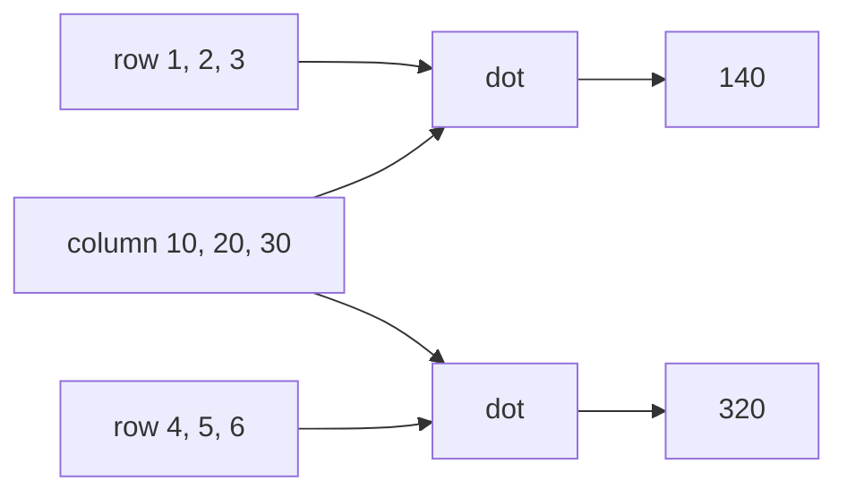
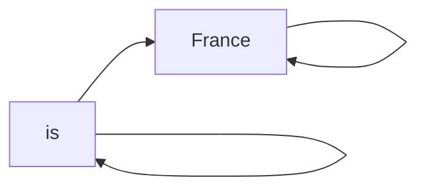
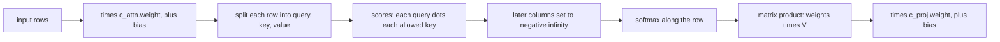
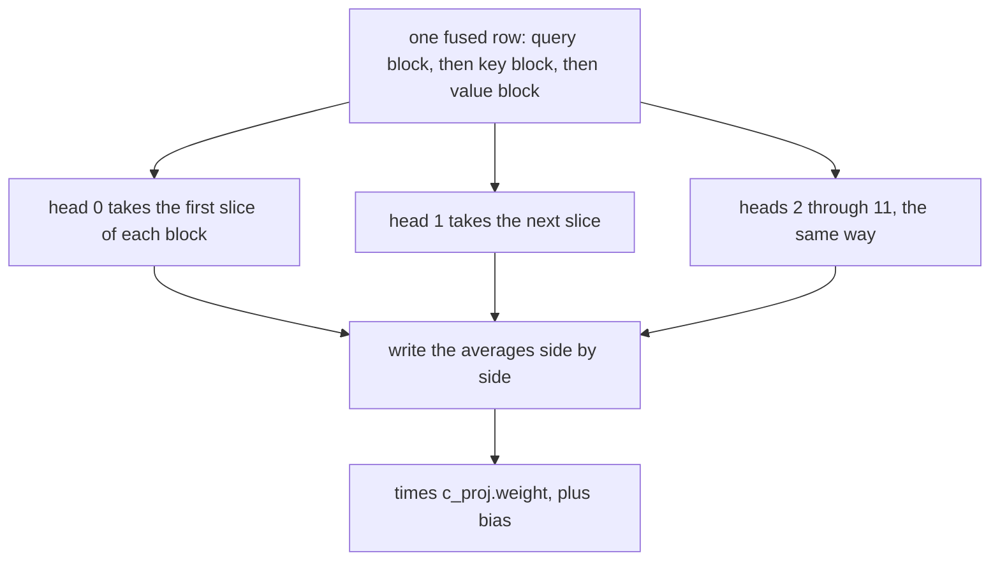
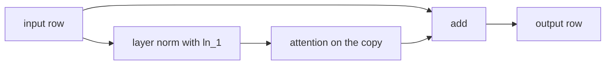
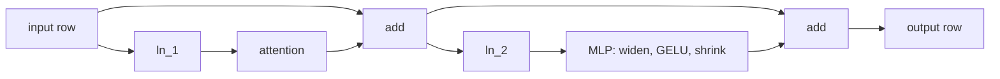

Stage notes for "The capital of France is". The stages send smaller inputs, so the arithmetic below uses those inputs. The same steps run on the five real rows.

| Position | Id | Token |
| --- | --- | --- |
| 0 | 464 | The |
| 1 | 3139 | ` capital` |
| 2 | 286 | ` of` |
| 3 | 4881 | ` France` |
| 4 | 318 | ` is` |

| Topic | Package or file |
| --- | --- |
| Bytes | `internal/safetensors` |
| Arithmetic | `internal/tensor` |
| Layers | `internal/nn` |
| GPT-2 | `internal/models/gpt2` |
| Generation | `internal/generate` |
| Keys and values | `internal/models/kv_cache` |
| Prefill, decode, mask | `kv-cache.md` |
| Commands, memory | `README.md` |

## The file of weights

`model.safetensors` is named tensors. Each tensor is a flat list plus a shape. Shape `[4]` is four numbers in a line. Shape `[2, 3]` is two rows of three. The file does no arithmetic.

`inspect` prints the name, the dtype, the shape, and the first four values, in alphabetical order.

#### Bytes on disk

1. Read 8 bytes as an unsigned integer, little-endian. That integer, `N`, is the length of the header that follows.
2. Read the next `N` bytes and parse them as JSON. One entry per tensor.
3. Everything after the JSON is the raw numbers.

`scale`, holding `1`, `0.5`, `0.25`, and `0.125`:

```json
{
  "scale": {
    "dtype": "F32",
    "shape": [4],
    "data_offsets": [0, 16]
  }
}
```

| Field | Meaning |
| --- | --- |
| `data_offsets` | Byte range inside step 3. The 8-byte length and the JSON sit in front, so they are outside the offset. |
| `[0, 16)` | Four float32 values, 4 bytes each. |
| `F32` | Little-endian float32. |
| `I32` | Signed integer, stored as float32. The rest of the engine adds and multiplies one numeric type. |
| `__metadata__` | Skipped. |
| Any other dtype | Load stops. |

`inspect` on that file:

```json
[
  {
    "name": "scale",
    "dtype": "F32",
    "shape": [4],
    "first": [1.0, 0.5, 0.25, 0.125]
  }
]
```

#### How a flat list becomes rows

Shape `[rows, columns]`: row `r` starts at index `r * columns`.

```text
wte.weight, shape [2, 2]

index      0    1    2    3
values     1    2    3    4
           ------   ------
           row 0    row 1
```

Row 0 is `[1, 2]`. Row 1 is `[3, 4]`. A GPT-2 row is 768 numbers, so row `r` starts at `r * 768`. `embed` uses `Shape[1]` as that width.

#### What sits in the GPT-2 file

The stage description counts 160 named tables.

```text
model.safetensors
├── wte.weight      one row of 768 numbers for each of 50,257 tokens
├── wpe.weight      one row of 768 numbers for each of 1,024 positions
├── h.0.…           13 tables for layer 0
├── h.1.…           13 tables for layer 1, and so on through h.11
├── ln_f.weight
└── ln_f.bias
```

Twelve tables under each `h.N` are learned weights.

| Used by | Tables |
| --- | --- |
| Attention | `c_attn`, `c_proj`, `ln_1` |
| MLP | `ln_2`, `mlp.c_fc`, `mlp.c_proj` |
| Final layer norm, after the stack | `ln_f.weight`, `ln_f.bias` |

The thirteenth, in the usual Hugging Face export, is `h.N.attn.bias`, a causal mask stored as data. This engine builds that mask with `nn.CausalMask` and leaves the stored table unread. The 548 MB file was not opened to confirm that name. The count of 13 comes from the stage text.

## From an id to a row

An id names a token. `wte.weight` is the learned row for an id. That row has no position. `wpe.weight` is a second learned row for each position, 0 through 1,023 in GPT-2. The embedding adds the two rows. "is" keeps the same `wte` row wherever it sits, and adds the `wpe` row for its own index.

The embed stage sends two `[2, 2]` tables, not the five ids above. `ids.json` is `[1, 0]`.

```text
wte.weight    1  2
              3  4

wpe.weight    10 20
              30 40
```

| Position | Id | wte row | wpe row | Sum |
| --- | --- | --- | --- | --- |
| 0 | 1 | row 1 `[3, 4]` | row 0 `[10, 20]` | `[13, 24]` |
| 1 | 0 | row 0 `[1, 2]` | row 1 `[30, 40]` | `[31, 42]` |

`embed` prints `[[13, 24], [31, 42]]`.

## What multiply does

| Kind | Weights | Call |
| --- | --- | --- |
| Matrix product | `c_attn`, `c_proj`, MLP `c_fc`, MLP `c_proj` | `tensor.MatMul`. A row is combined with a whole matrix. |
| Per-column scale | `ln_1.weight`, `ln_2.weight`, `ln_f.weight` | `tensor.BroadcastMultiply`. One number per column, copied onto every token. |
| Bias | `c_attn.bias`, `c_proj.bias`, `ln_1.bias`, and the other bias lists | `add`. Same shape of vector, added. |

Both calls clone the values before writing, so the caller's tensor stays as it was.

Each entry of a matrix product is a dot product along the shared side. The result has the left tensor's height and the right tensor's width. This is the product that turns the row for "is" into its query, key, and value. The stage checks it with a `[2, 3]` matrix and the column `10, 20, 30`:

$$
\begin{bmatrix}
1 & 2 & 3 \\
4 & 5 & 6
\end{bmatrix}
\begin{bmatrix}
10 \\ 20 \\ 30
\end{bmatrix}
=
\begin{bmatrix}
1\cdot 10 + 2\cdot 20 + 3\cdot 30 \\
4\cdot 10 + 5\cdot 20 + 6\cdot 30
\end{bmatrix}
=
\begin{bmatrix}
140 \\
320
\end{bmatrix}
$$



One token, such as "is" by itself, is the same product with one row on the left:

$$
\begin{bmatrix} 1 & 2 \end{bmatrix}
\begin{bmatrix} 3 & 4 \\ 5 & 6 \end{bmatrix}
=
\begin{bmatrix} 1\cdot 3 + 2\cdot 5 & 1\cdot 4 + 2\cdot 6 \end{bmatrix}
=
\begin{bmatrix} 13 & 16 \end{bmatrix}
$$


`tensor.BroadcastMultiply` copies a list onto every row and scales each column by its own entry. Stored as shape `[3]`:

```text
1  2  3      10  20  30      10   40   90
4  5  6   *  10  20  30   =  40  100  180
```

## One head of attention

After embedding, "is" is one row of 768 numbers. That row does not contain "The" or "France". Attention replaces the row with a weighted average of this row and the earlier rows. A position cannot see later rows.

Weights from one head, in a later layer, for "is":

| The | capital | of | France | is |
| --- | --- | --- | --- | --- |
| 0.347 | 0.017 | 0.007 | 0.571 | 0.058 |

More than half of that average comes from "France".

Mask for "France" then "is". "France" can use only itself. "is" can use "France" and itself.



| List | Role |
| --- | --- |
| Query | What this position is looking for. |
| Key | What other positions compare against. |
| Value | What gets mixed in when this position is chosen. |

The score between positions `i` and `j` is the dot product of query `i` and key `j`, divided by the square root of the list length. A longer list makes a larger dot for the same match, so the square root keeps a width of 1 and GPT-2's width of 768 on a similar scale.

$$
\mathrm{score}_{ij} = \frac{q_i \cdot k_j}{\sqrt{d}}
$$

Softmax turns one row of scores into weights that add up to 1. The code subtracts the largest score in the row before `exp`. The weights come out the same, and `exp` of a large number does not overflow. A score that leads another by 2 gets about `e^2`, roughly 7 times the weight.

$$
\mathrm{weight}_i = \frac{e^{z_i - z_{\max}}}{\sum_j e^{z_j - z_{\max}}}
$$



#### Stage input

`n_embd` is 1, so every row is one number instead of the 768 numbers in "is". Input: `[[1], [2]]`, shape `[2, 1]`. `c_attn.weight` is `[1, 3]`, filled with ones. `c_attn.bias` is `[0, 0, 0]`. Each input number is copied into the query, the key, and the value.

$$
\begin{bmatrix} 1 \\ 2 \end{bmatrix}
\begin{bmatrix} 1 & 1 & 1 \end{bmatrix}
=
\begin{bmatrix}
1 & 1 & 1 \\
2 & 2 & 2
\end{bmatrix}
$$

The bias is a list of length 3, added to every row. Here every entry is zero.

```text
position 0    query 1    key 1    value 1
position 1    query 2    key 2    value 2
```

Dividing by `sqrt(1)` changes nothing. Left: scores, with the forbidden later column as negative infinity. Right: softmax. `exp` of negative infinity is 0, so that column's weight is 0.

$$
\begin{bmatrix}
1 & -\infty \\
2 & 4
\end{bmatrix}
\xrightarrow{\text{softmax}}
\begin{bmatrix}
1 & 0 \\
0.119 & 0.881
\end{bmatrix}
$$

Position 0 has one finite score. Its weight on itself is 1. Its new value is `1 * 1 = 1`.

Position 1, scores 2 and 4:

```text
exp(2) = 7.389056
exp(4) = 54.598150
sum    = 61.987206

weights   7.389056 / 61.987206 = 0.119203
          54.598150 / 61.987206 = 0.880797

new value 0.119203 * 1 + 0.880797 * 2 = 1.880797
```

That sum is the product of the weight matrix with the value column. Shape `[2, 2]` times shape `[2, 1]` is shape `[2, 1]`:

$$
\begin{bmatrix}
1 & 0 \\
0.119203 & 0.880797
\end{bmatrix}
\begin{bmatrix} 1 \\ 2 \end{bmatrix}
=
\begin{bmatrix}
1\cdot 1 + 0\cdot 2 \\
0.119203\cdot 1 + 0.880797\cdot 2
\end{bmatrix}
=
\begin{bmatrix} 1 \\ 1.880797 \end{bmatrix}
$$

`c_proj.weight` is `[[1]]` and `c_proj.bias` is `[0]`, so the last product leaves both numbers as they are. `attn` prints `[[1.0], [1.8807970779778822]]`.

`n_positions` is the longest prompt the model was sized for: 4 in this stage, 1,024 in GPT-2. The rows in this call are `inputTensor.Shape[0]`.

## Twelve heads

One head puts most of its weight on one relationship. The head above puts 0.571 on "France" when scoring "is". "capital" is left with 0.017. GPT-2 runs 12 heads on the same rows. Each head has its own slice of the query, the key, and the value. The twelve averages are written side by side, and the row is 768 numbers wide again.

A second head in that layer, also scoring "is":

| The | capital | France |
| --- | --- | --- |
| 0.633 | 0.236 | 0.047 |



| Item | Value |
| --- | --- |
| `n_head` | From `config.json`. |
| Slice width | `n_embd / n_head`. |
| GPT-2 | 768 and 12, so a slice is 64. The score divides by `sqrt(64)`. |
| Single-head stage | The whole row was the slice, so the divisor was `sqrt` of the whole row. |
| `c_attn.weight` | Shape `[n_embd, 3 * n_embd]`. Runs once, before the split. |
| Head 0 | First `head width` columns of each block. |
| Head 1 | The next band. |
| `nn.SplitHeads` | Copies each band out. |
| `nn.MergeHeads` | Joins the attended bands. |

#### Stage input

`n_embd` 2, `n_head` 2. Each head is one number wide. Two rows, in place of two tokens:

$$
\begin{bmatrix}
1 & 0 \\
0 & 1
\end{bmatrix}
$$

Position 0's fused row is `1, 0` three times. Position 1's fused row is `0, 1` three times. The vertical bars split query, key, and value. Inside a block, the first number is head 0 and the second is head 1.

$$
\begin{array}{cc|cc|cc}
q_0 & q_1 & k_0 & k_1 & v_0 & v_1 \\
\hline
1 & 0 & 1 & 0 & 1 & 0 \\
0 & 1 & 0 & 1 & 0 & 1
\end{array}
$$

```text
head 0                         head 1
pos 0    Q 1   K 1   V 1       pos 0    Q 0   K 0   V 0
pos 1    Q 0   K 0   V 0       pos 1    Q 1   K 1   V 1
```

Position 0 can only see itself, so each head gives it weight 1. Its output stays `[1, 0]`.

Position 1, head 0. Query is 0. Keys are 1, then 0. Both scores are 0. Softmax of two equal scores is `[0.5, 0.5]`. Values are 1 and 0. Average: `0.5 * 1 + 0.5 * 0 = 0.5`.

Position 1, head 1. Query is 1. Keys are 0, then 1. Scores are 0 and 1.

```text
exp(0) = 1
exp(1) = 2.718282
sum    = 3.718282

weights   1 / 3.718282         = 0.268941
          2.718282 / 3.718282  = 0.731059

values in this column are 0, then 1
average   0.268941 * 0 + 0.731059 * 1 = 0.731059
```

The two averages sit side by side as `[0.5, 0.731059]`. `c_proj` leaves the row unchanged. `attn` prints `[[1.0, 0.0], [0.5, 0.7310585786300049]]`.

## Residual and layer norm

The block adds attention's average back onto the row it started from, so the original token is still present. GPT-2 stacks 12 of these blocks.



The arrow that skips layer norm is the residual. Attention sees the normalized copy. The add sees the row from before that copy was made.

Each block first rescales a copy to mean 0 and standard deviation about 1. Then `ln_1.weight` scales each column and `ln_1.bias` shifts it, using the per-column scale from What multiply does. The mean and the population variance are taken over that one row. `nn.LayerNorm` applies the configured epsilon, weight, and bias.

$$
\operatorname{layernorm}(x) = \frac{x - \mathrm{mean}}{\sqrt{\mathrm{variance} + 0.00001}} \cdot \mathrm{weight} + \mathrm{bias}
$$

The dot is the broadcast multiply: one scale per column, copied onto every token. `0.00001` is GPT-2's `layer_norm_epsilon`.

A row and that same row times ten come out almost the same. Take `[2, 4, 6, 8]`.

| | `[2, 4, 6, 8]` | `[20, 40, 60, 80]` |
| --- | --- | --- |
| Mean | 5 | 50 |
| Deviations | `-3, -1, 1, 3` | `-30, -10, 10, 30` |
| Variance | `(9 + 1 + 1 + 9) / 4 = 5` | 100 times larger |
| After dividing by `sqrt(variance + 0.00001)` | about `-1.34, -0.45, 0.45, 1.34` | the same quotients, because the square root is ten times larger |

#### Stage input

`[[1, 2]]`, one token, not a 768-wide row. `ln_1.weight` is `[1, 1]`. `ln_1.bias` is `[0, 0]`. Attention's weights copy a row into its query, key, and value. There is only one position, so attention returns that row unchanged.

```text
mean         (1 + 2) / 2 = 1.5
variance     (0.5^2 + 0.5^2) / 2 = 0.25
scale        sqrt(0.25 + 0.00001) = sqrt(0.25001) ≈ 0.50001
normalized   -0.5 / 0.50001 ≈ -0.99998
              0.5 / 0.50001 ≈  0.99998
times [1, 1] and plus [0, 0] leaves that row

attention    about [-1, 1]
output       [1, 2] + [-1, 1] = about [0, 3]
```

The precise first number is about `1.99994e-05`. The tester accepts that as `0` within `0.0001`. At the precision the stage prints, `block` shows `[[0.0, 3.0]]`.

`gpt2.Model.Block` continues through `ln_2` and the MLP, then adds the second residual.

## MLP

The MLP runs on each row by itself, including the row for "is". It holds most of the numbers in a block.

| Step | Shape |
| --- | --- |
| Widen | `n_embd` to `4 * n_embd`. 768 becomes 3,072. |
| GELU | Negative numbers move toward 0. Positive numbers stay close to themselves. |
| Shrink | Back to `n_embd`. |
| Add | Second residual, same pattern as attention. |



The GELU the tester scores is the tanh approximation. An exact GELU can differ by about `0.0005`, enough to fail.

#### GELU references
(Ref 1.)[https://www.analyticsvidhya.com/blog/2026/10/gelu-activation-function-explained/]
(Ref 2.)[https://pub.towardsai.net/is-gelu-the-relu-successor-deep-learning-activations-7506cf96724f]
(Ref 3.)[https://jacar.es/en/gelu-activation-function/]

$$
\operatorname{gelu}(x) = 0.5 \cdot x \cdot \left(1 + \tanh\left(\sqrt{\frac{2}{\pi}}\left(x + 0.044715 \cdot x^{3}\right)\right)\right)
$$

Continue the `[[1, 2]]` block. After the first residual the row is about `[0, 3]`. `ln_2`, weight `[1, 1]` and bias `[0, 0]`, normalizes it to about `[-1, 1]`. The widen step in this stage keeps those two numbers and fills the rest with zeros, so GELU sees `[-1, 1, 0, 0, 0, 0, 0, 0]`.

| Input | GELU |
| --- | --- |
| `-1` | about `-0.1588` |
| `1` | about `0.8412` |
| `0` | `0` |

The shrink step puts the first two numbers back. They are added onto `[0, 3]`:

```text
[0, 3] + [-0.1588, 0.8412] = [-0.1588, 3.8412]
```

The stage prints `[[-0.15878819, 3.84116958]]`.

## When the numbers look wrong

| What you see | What is causing it |
| --- | --- |
| `inspect` shows an unexpected shape, or `first` is a jumble of huge and tiny values | The header length, the JSON, or `data_offsets` started at the wrong byte. Offsets begin at the data region, after the 8-byte length and the header. |
| An embedding row has the right width and the wrong token | The row started at `id * Shape[0]`, or the slice was allocated with `Shape[0]`. A row is `Shape[1]` long and starts at `id * Shape[1]`. |
| Attention says `n_pos: 4` while the loaded matrix has 2 rows | The position count came from `n_positions`. The rows in this call are `inputTensor.Shape[0]`. |
| A one-column attention result is about `1.88` on the second row | Scores 2 and 4 became weights about `0.119` and `0.881`, then `0.119 * 1 + 0.881 * 2`. That is the single-head stage. |
| Two-head output is `[[1, 0], [0.5, 0.73]]` | Head 0 split two equal scores into `[0.5, 0.5]`. Head 1 split scores 0 and 1 into about `[0.269, 0.731]`. The divisor is `sqrt(1)`, the slice width. |
| A one-token projection has the shape of the weight matrix, and each column looks scaled | The projection went through `tensor.BroadcastMultiply`. `c_proj.weight` is a matrix product, so the call is `tensor.MatMul`. |
| The block on `[[1, 2]]` prints about `[[0, 3]]` | Layer norm of `[1, 2]` is about `[-1, 1]`, one-row attention returns it, and the residual is `[1, 2] + [-1, 1]`. |
| That same block prints about `0.001996` in the first column | The denominator was `sqrt(variance) + eps`. The formula divides by `sqrt(variance + 0.00001)`. |
| `[[1, 2]]` through the full block is about `[-0.159, 3.841]` | `ln_2` produced about `[-1, 1]`, GELU bent those to about `-0.1588` and `0.8412`, and that pair was added onto `[0, 3]`. |
