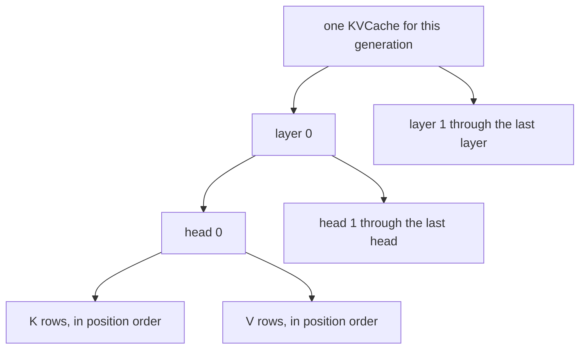
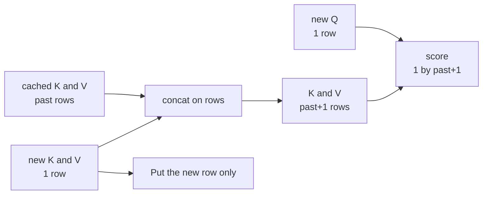
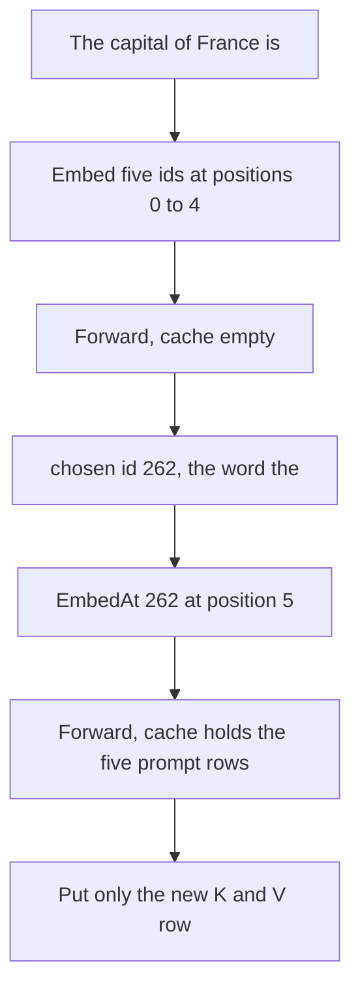

## Key-value cache

This page explains why generation keeps a key-value cache, how the engine fills and reads it, and the two bugs that make a cached run disagree with a full recompute. The code lives in `internal/models/kv_cache`, and the attention code that uses it is in `internal/models/gpt2/model.go`.

[KV Caching explained](https://medium.com/@joaolages/kv-caching-explained-276520203249) is a good visual introduction to the idea.

#### Why a cache helps

When the model generates a new token, the new token's query has to be compared with the key of every earlier token, and the resulting weights are used to mix their values. The keys and values of earlier tokens never change once they are computed, because the causal mask stops an earlier token from ever looking at a later one. Recomputing them on every step is therefore wasted work. The cache stores each token's key and value the first time they are computed, so that every later step only has to run the newest token through the model.

Queries do not need to be stored. A token's query is only used to compute that token's own output, and once its output has been produced the query is never needed again. Its key and value, on the other hand, are read by every token that comes after it.

#### Who uses the cache

| Caller | How it uses the cache |
| --- | --- |
| `Greedy`, `TopP` | They call `GetKVCache` once and pass the same pointer into every `Forward` call for that generation. `Forward` hands it to each block, and attention reads from and appends to it while computing each head's scores. |
| `attn`, `block`, `logits` | They pass a nil cache. Every input row is recomputed, nothing is stored, and every input row is returned. These commands are checked against a full recompute, so they must not depend on earlier calls. |

#### How the cache is organised

The cache holds two maps, one for keys and one for values. Each map is indexed by layer and then by head. A slot is a list of tensors: prefill appends one tensor holding every prompt row, and each decode step appends one tensor holding a single row. `Get` stacks the list into one tensor, so the rows come back in position order.

| Call | What it does |
| --- | --- |
| `Get` | Returns the slot's rows stacked into one tensor. An empty slot returns shape `[0, 0]`. |
| `Put` | Appends the tensor passed in to the end of the slot's list. |



The sections below follow the prompt "The capital of France is", with ids `[464, 3139, 286, 4881, 318]`. GPT-2 has `n_embd` 768 and 12 heads, so each head works on `head_dim` = 768 / 12 = 64 columns. The first generated id in the walkthrough is `262` (" the").

#### Prefill: the first generated token

The first step has nothing cached yet, so it embeds the whole prompt and runs it through the model. This step is called prefill because it fills the cache with every prompt token's keys and values.

| | This prompt | In general |
| --- | --- | --- |
| Positions | 0 through 4 | 0 through `L - 1` |
| Block input | `[5, 768]` | `[L, n_embd]` |
| `c_attn` output | `[5, 3*768]` | `[L, 3*n_embd]`, a fused row of `Q \| K \| V` |
| One head's Q, K, V | `[5, 64]` | `[L, d]` |
| Score | `[5, 5]` | `[L, L]` |
| What gets stored with `Put` | That head's full K and full V | The same |

Here `L` is the prompt length and `d` is `head_dim`.

Each head cuts its own columns out of the fused `c_attn` row. For head `h`, the starting column inside each block is:

| Block | Start column |
| --- | --- |
| Query | `h * d` |
| Key | `n_embd + h * d` |
| Value | `2 * n_embd + h * d` |

```text
one fused row, width 3 * n_embd

[ Q heads | K heads | V heads ]
  ^          ^          ^
  head * head_dim inside each block
```

Because the slot is empty, the score is computed from the rows that were just cut out:

$$
Q, K, V \in \mathbb{R}^{L \times d}
\qquad
\mathrm{score} = \frac{Q K^{T}}{\sqrt{d}} \in \mathbb{R}^{L \times L}
$$

Each block returns all `L` rows, because the next layer needs every prompt row to compute its own keys and values. Only the output head, after the last layer, reduces the result to the final row.

#### Decode: every later token

From the second step onwards, only the newest token is run through the model. For this prompt the second step calls `EmbedAt(262, 5)`. Position 5 is the index of `262` in the full context `[464, 3139, 286, 4881, 318, 262]`, and it selects which `wpe` row is added to the token's embedding. Calling `Embed(262)` instead would add the `wpe` row for position 0, and the model would treat " the" as the first word of the text.

In the table below `p` is the number of rows already in the cache.

| | This prompt, second step | In general |
| --- | --- | --- |
| Block input | `[1, 768]` | `[1, n_embd]` |
| `c_attn` output | `[1, 3*768]` | `[1, 3*n_embd]` |
| New Q, K, V | `[1, 64]` | `[1, d]` |
| K and V used for the score | The 5 cached rows with the new row appended, `[6, 64]` | `[p+1, d]` |
| Q used for the score | `[1, 64]` | `[1, d]` |
| Score | `[1, 6]` | `[1, p+1]` |
| What gets stored with `Put` | Only the new K row and the new V row | Only the new row. The concatenated tensor is not written back, because that would store the old rows a second time. |

$$
K = \begin{bmatrix} K_{\mathrm{cache}} \\ k_{\mathrm{new}} \end{bmatrix} \in \mathbb{R}^{(p+1) \times d}
\qquad
Q \in \mathbb{R}^{1 \times d}
\qquad
\mathrm{score} = \frac{Q K^{T}}{\sqrt{d}} \in \mathbb{R}^{1 \times (p+1)}
$$



The decode branch reads only row 0 of the `c_attn` output, so it assumes the input holds exactly one new token. Passing more than one row on a decode step would silently drop the extra rows.

This is where the saving comes from. On a decode step, layer norm, `c_attn`, and the MLP each run on a single row, and the score compares one query against `p+1` keys. Recomputing the same context from scratch would run all of those on every row and build a full `[p+1, p+1]` score.

#### Why the causal mask needs an offset

The causal mask stops a position from attending to positions after it, by setting those scores to negative infinity before softmax. `nn.CausalMask` hides column `j` in row `i` when `j > past + i`, where `past` is the number of cached rows that come before the rows in this call. The attention code works `past` out from the shapes:

$$
\mathrm{past} = \mathrm{rows}(V) - \mathrm{rows}(\mathrm{score})
$$

Here is what that looks like for a request of two new tokens, where the first chosen id is `262`:

| Step | Input | One head | Score | `past` |
| --- | --- | --- | --- | --- |
| 1 (prefill) | Five ids at positions 0 to 4 | Q, K, V are `[5, 64]`. The slot is empty. | `[5, 5]` | `5 - 5 = 0` |
| 2 (decode) | `EmbedAt(262, 5)` | New Q, K, V are `[1, 64]`. The cache holds `[5, 64]`, so after concatenation K and V are `[6, 64]`. | `[1, 6]` | `6 - 1 = 5` |



In step 1, `past` is 0, so this is the ordinary triangular mask. "The" can only see itself, and "is" can see the whole prompt. Rows and columns are, in order, "The", "capital", "of", "France", "is":

$$
\begin{bmatrix}
s_{00} & -\infty & -\infty & -\infty & -\infty \\
s_{10} & s_{11} & -\infty & -\infty & -\infty \\
s_{20} & s_{21} & s_{22} & -\infty & -\infty \\
s_{30} & s_{31} & s_{32} & s_{33} & -\infty \\
s_{40} & s_{41} & s_{42} & s_{43} & s_{44}
\end{bmatrix}
$$

In step 2, `past` is 5. For row 0, the mask would start hiding at column `past + 0 + 1` = 6, but the score only has columns 0 through 5, so nothing is hidden. " the" can see "The", "capital", "of", "France", "is", and itself, which is correct because it is the last token in the sequence:

$$
\begin{bmatrix} s_{0} & s_{1} & s_{2} & s_{3} & s_{4} & s_{5} \end{bmatrix}
$$

If the mask ignored `past` and used the raw row index, row 0 would be treated as position 0. Every column after the first would be hidden, and " the" would attend only to "The":

$$
\begin{bmatrix} s_{0} & -\infty & -\infty & -\infty & -\infty & -\infty \end{bmatrix}
$$

This bug does not produce an error. The shapes are all valid and the model still generates tokens, but they are different from what a full recompute would produce. The reliable check is to compare cached generation against a run that recomputes the whole context on every step; the two must pick the same ids.

#### When the cache is wrong

| What you see | What is causing it |
| --- | --- |
| The second token's hidden state looks like a token at position 0 | The new id was embedded with `Embed`, which adds the `wpe` row for position 0. Decode has to use `EmbedAt` with the token's index in the full context. |
| A later token attends only to the first prompt token | `nn.CausalMask` was given `past = 0` on a score with `past + 1` columns, so row 0 was treated as position 0. |
| `attn` or `block` gives different results after a `generate` in the same process | Those commands received the generation cache. They must pass `nil`, recompute every input row, and never call `Put`. |
| A later layer's keys are a copy of the previous layer's keys | One layer's slot was reused for the next layer. The cache key must include both the layer and the head. |
| The prompt's keys are missing on the second token | Prefill stored only the last row. The first call's input is the whole prompt, and `Put` must store every row of it. |
| A second generation in the same process starts from the wrong context | `GetKVCache` returns a pointer to the model's own cache field, so every generation shares one cache. The CLI runs one command per process, so this does not happen today, but a long-running caller would need to create a fresh cache for each generation. |
| `Concat error: invalid shapes` during decode | The new K or V row is wider than `head_dim`, or its number of values does not match the shape `[1, head_dim]`. |
