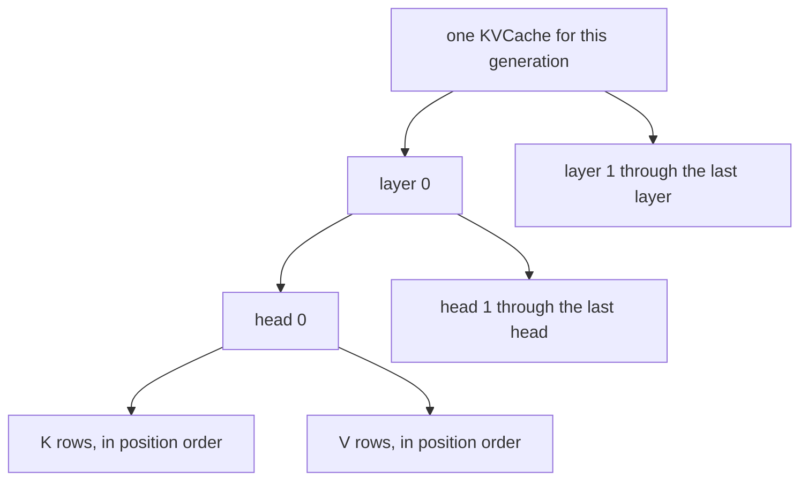
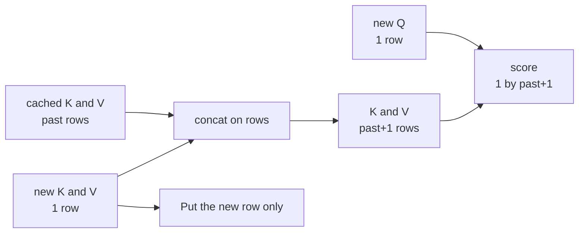
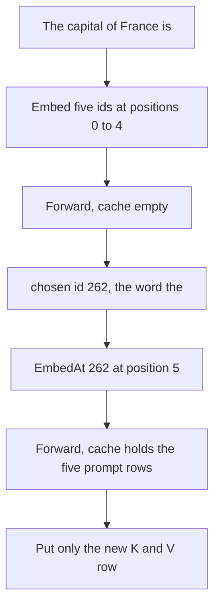

## Key-value cache

#### Useful read
[KV Caching explained](https://medium.com/@joaolages/kv-caching-explained-276520203249)

Each new token needs a query against every earlier key. Earlier keys and values do not change, so they are stored and the new token runs alone.

Package: `internal/models/kv_cache`.

| Caller | Cache |
| --- | --- |
| `Greedy`, `TopP` | `GetKVCache` once. The same pointer goes into every `Forward` of that generation. `Forward` passes it to each block. Attention reads and appends inside the per-head score. |
| `attn`, `block`, `logits` | Nil. Full recompute. No `Put`. Every input row is returned. |

Two maps, K and V. Lookup is layer, then head. A slot holds rows in position order.

| Call | Result |
| --- | --- |
| `Get` | One tensor, rows stacked in order. An empty slot has shape `[0, 0]`. |
| `Put` | Appends the rows from this call. |
| Query | Not stored. After a position's logits are taken, its query is unused. Its key is used by every later query. |



Prompt used below: "The capital of France is", ids `[464, 3139, 286, 4881, 318]`. GPT-2: `n_embd` 768, 12 heads, `head_dim` 64. First chosen id in the walkthrough: `262` (" the").

#### Prefill

First generated token. `embedStep` embeds the whole prompt.

| | This prompt | In general |
| --- | --- | --- |
| Positions | `0` through `4` | `0` through `prompt_len - 1` |
| Block input | `[5, 768]` | `[L, n_embd]` |
| `c_attn` output | `[5, 3*768]` | `[L, 3*n_embd]`, fused `Q \| K \| V` |
| One head's Q, K, V | `[5, 64]` | `[L, d]` |
| Score | `[5, 5]` | `[L, L]` |
| `Put` | That head's full K and full V | Same |

`L` is the prompt length. `d` is `head_dim` (`n_embd / n_heads`).

Column starts inside the fused row, for head `h`:

| Block | Start column |
| --- | --- |
| Query | `h * d` |
| Key | `n_embd + h * d` |
| Value | `2 * n_embd + h * d` |

```text
one fused row, width 3 * n_embd

[ Q heads | K heads | V heads ]
  ^          ^          ^
  head * head_dim inside each block
```

The slot is empty, so the score uses the copied rows as they are.

$$
Q, K, V \in \mathbb{R}^{L \times d}
\qquad
\mathrm{score} = \frac{Q K^{T}}{\sqrt{d}} \in \mathbb{R}^{L \times L}
$$

The block returns every prompt row. The next layer reads those rows. Only the logits head, after the last layer, keeps the final row.

#### Decode

Each later token. For this prompt the second call is `EmbedAt(262, 5)`. Position `5` is the index in `[464, 3139, 286, 4881, 318, 262]`, and it selects the `wpe` row. `Embed(262)` would add the `wpe` row for position `0`.

`p` is the number of cached rows.

| | This prompt, second call | In general |
| --- | --- | --- |
| Block input | `[1, 768]` | `[1, n_embd]` |
| `c_attn` output | `[1, 3*768]` | `[1, 3*n_embd]` |
| New Q, K, V | `[1, 64]` | `[1, d]` |
| K and V used for the score | cached rows concatenated with the new row, `[6, 64]` | `[p+1, d]` |
| Q used for the score | `[1, 64]` | `[1, d]` |
| Score | `[1, 6]` | `[1, p+1]` |
| `Put` | The new K row and the new V row | The new row only. The concatenated tensor stays out of the cache. |

$$
K = \begin{bmatrix} K_{\mathrm{cache}} \\ k_{\mathrm{new}} \end{bmatrix} \in \mathbb{R}^{(p+1) \times d}
\qquad
Q \in \mathbb{R}^{1 \times d}
\qquad
\mathrm{score} = \frac{Q K^{T}}{\sqrt{d}} \in \mathbb{R}^{1 \times (p+1)}
$$



On a decode step, layer norm, `c_attn`, and the MLP run on one row. The score multiplies one query by `p+1` keys. A full pass over the same ids would build a `[seq, seq]` score.

#### Worked mask

Request: two new tokens. First chosen id: `262`.

| Step | Input | One head | Score | `past` |
| --- | --- | --- | --- | --- |
| 1 | five ids at positions `0` to `4` | Q, K, V `[5, 64]`. Slot empty. | `[5, 5]` | `rows(V) - rows(score) = 0` |
| 2 | `EmbedAt(262, 5)` | New Q, K, V `[1, 64]`. Cache holds `[5, 64]`. After concat, K and V are `[6, 64]`. | `[1, 6]` | `6 - 1 = 5` |



Step 1. `nn.CausalMask` hides column `j` when `j > i`. "The" sees only itself. "is" sees the whole prompt. Both K and V are stored.

$$
\begin{bmatrix}
s_{00} & -\infty & -\infty & -\infty & -\infty \\
s_{10} & s_{11} & -\infty & -\infty & -\infty \\
s_{20} & s_{21} & s_{22} & -\infty & -\infty \\
s_{30} & s_{31} & s_{32} & s_{33} & -\infty \\
s_{40} & s_{41} & s_{42} & s_{43} & s_{44}
\end{bmatrix}
$$

Rows and columns, in order: "The", "capital", "of", "France", "is".

Step 2. `past` is 5. The mask starts at column `past + row + 1` = column `6`. The score only has columns `0` through `5`, so nothing is hidden. " the" sees every key: "The", "capital", "of", "France", "is", and itself.

$$
\mathrm{past} = \mathrm{rows}(V) - \mathrm{rows}(\mathrm{score}) = 6 - 1 = 5
$$

$$
\begin{bmatrix} s_{0} & s_{1} & s_{2} & s_{3} & s_{4} & s_{5} \end{bmatrix}
$$

`nn.CausalMask` receives that `past`. On this `[1, 6]` score, row `0` is position `5` in the sequence. A mask that used the raw row index would hide every column after `0`. " the" would attend only to "The":

$$
\begin{bmatrix} s_{0} & -\infty & -\infty & -\infty & -\infty & -\infty \end{bmatrix}
$$

#### When the cache is wrong

| What you see | What is causing it |
| --- | --- |
| The second token's hidden row matches position `0` | The new id was embedded with `Embed`, so its `wpe` row is `0`. Decode uses `EmbedAt` and the index in the full id list. |
| A later token attends only to the first prompt token | `past` passed to `nn.CausalMask` was `0` on a score whose width is `past+1`. Row `0` was treated as position `0`. |
| `attn` or `block` changes after a `generate` in the same process | Those commands received the generation cache. They pass `nil`, recompute every input row, and do not call `Put`. |
| A later layer's keys are a copy of the previous layer | One layer's slot was reused for the next layer. The map key is `(layer, head)`. |
| Prompt keys are missing on the second token | Prefill stored only the last row. The first call's input is the whole prompt, and `Put` stores every row of that call. |
| `Concat error: invalid shapes` on decode | The new K or V is wider than `head_dim`, or the value count does not match shape `[1, head_dim]`. |
